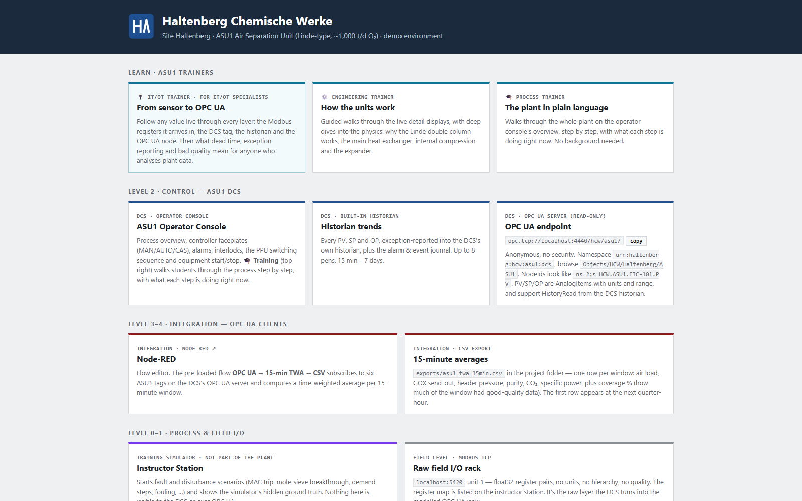
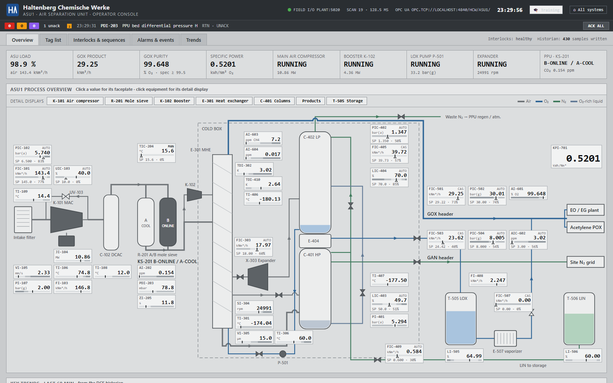
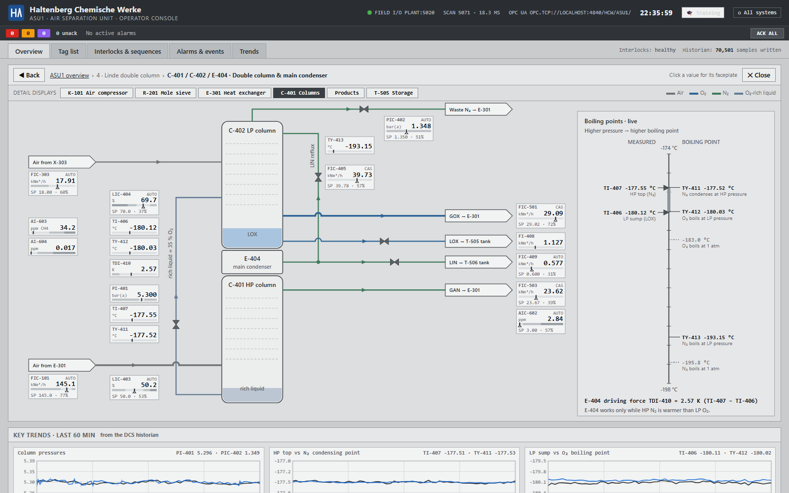
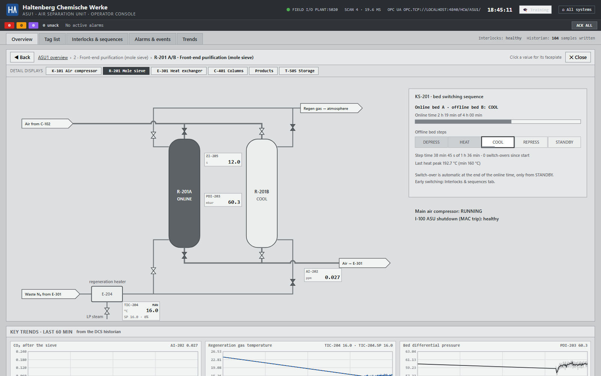
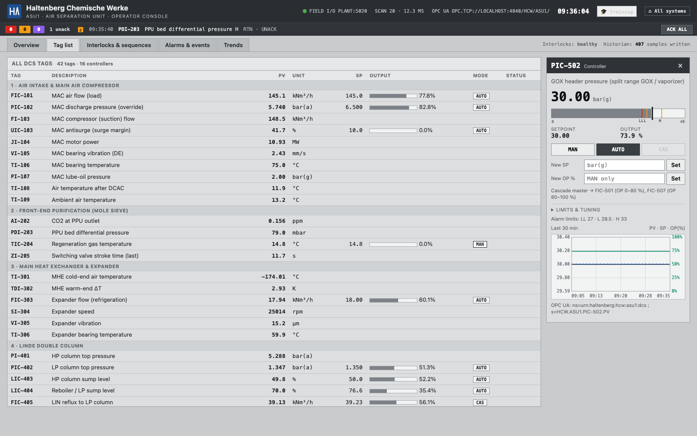
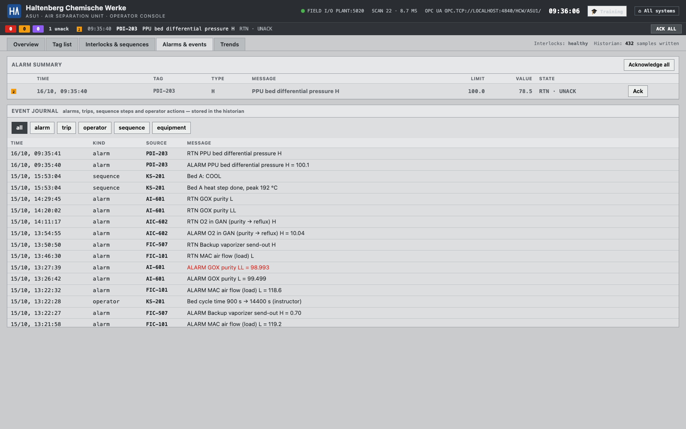
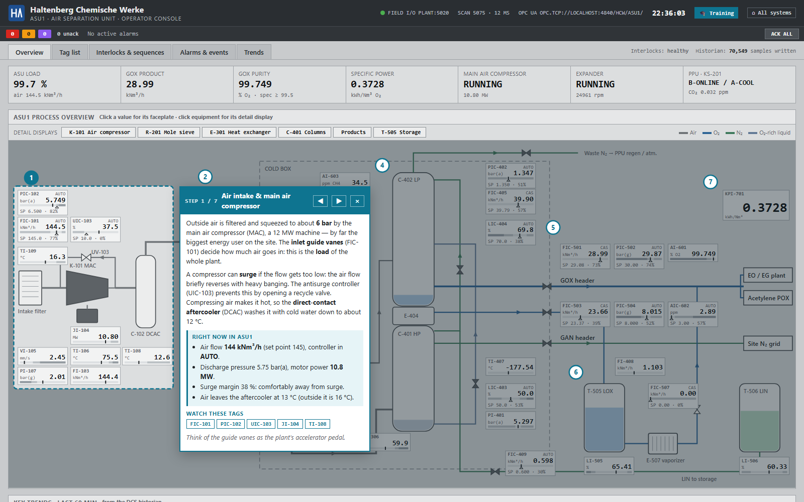
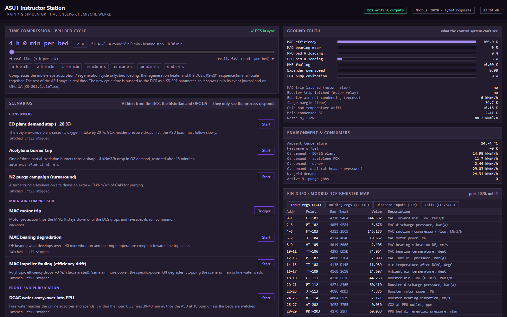
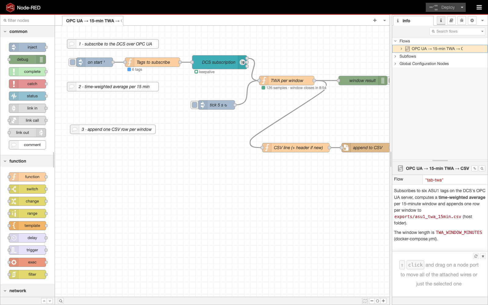

# HCW Haltenberg — ASU1 simulator & DCS

> **Disclaimer.** This code is part of the [IT/OT Academy](https://itot.academy), offered by
> [The IT/OT Insider](https://itotinsider.com). It is a generated, vibe-coded system made **only for
> demo purposes**. It may not be used for anything other than demonstration or training: not in
> production, not connected to real equipment, and not as the basis for any real control, quality
> or maintenance decision.
>
> Its main purpose is to explain the **classic process-industry stack**: field I/O over raw Modbus
> TCP, a DCS that turns it into modelled controller tags, a built-in historian, and OPC UA as the
> interface IT-side clients (here Node-RED) consume.

A demo plant for **Haltenberg Chemische Werke (HCW)**: a Linde-type **Air Separation Unit**
(~1,000 t/d O₂, ~145,000 Nm³/h air) simulated in real time, controlled by a small but complete
**DCS** with a **built-in historian**, which exposes its data over **OPC UA**.

The process model and control strategy follow `linde air seperation research.md`.

## Easiest way to start
Open Claude Code in this directory and run the following prompt:
```
read the CLAUDE.md file and README.md file and set up the environment
```

## Prerequisites

- Docker Desktop (or Docker Engine + Compose v2)
- Free host ports: **8110** (DCS console), **8111** (instructor station), **4840** (OPC UA),
  **5020** (Modbus TCP), **1880** (Node-RED)

## Start

```bash
docker compose up -d --build
```

Then open the hub at **http://localhost:8110**.

| What | Where |
|---|---|
| Hub (all systems) | http://localhost:8110 |
| DCS operator console | http://localhost:8110/operator |
| Historian trends | http://localhost:8110/operator#trends |
| Detail display (e.g. the columns) | http://localhost:8110/operator#detail/C-401 |
| Instructor station (fault scenarios) | http://localhost:8111 |
| OPC UA endpoint | `opc.tcp://localhost:4840/hcw/asu1/` (anonymous, no security) |
| Modbus TCP field I/O (raw) | `localhost:5020`, unit 1 |
| Node-RED (OPC UA client flows) | http://localhost:1880 |
| 15-min averages (CSV, written by Node-RED) | `exports/asu1_twa_15min.csv` |

## Screenshots

**Hub** — one page linking every system, grouped by ISA-95 level.



**DCS operator console — process overview.** ISA-101 style: grey by default, colour only for
alarms. Click any value to open its faceplate.



**Detail displays (ISA-101 level 3)** — click equipment on the overview, or use the
*Detail displays* bar, for one display per unit. Here the double column and main condenser, with a
live boiling-point scale: measured column temperatures against the boiling points at column
pressure.



The mole-sieve display shows both beds, the valve line-up commanded by the KS-201 sequence and the
step progress.



**Tag list and controller faceplate** — every DCS tag with PV, SP, output and mode. The faceplate
switches MAN/AUTO/CAS, changes setpoints and shows a 30-minute trend.



**Interlocks & sequences** — I-100 (ASU shutdown) and I-300 (expander trip) with their causes,
equipment start/stop, ESD, and the KS-201 mole-sieve bed switching sequence.


**Alarms & events** — alarm summary with acknowledge, and the event journal stored in the
historian.



**Historian trends** — up to 8 points, 15 min to 7 days. Here: the PPU cycle compressed to
5 min per bed: CO₂ at the PPU outlet, regeneration gas temperature, bed ΔP and valve stroke time over three bed switch-overs.


**🎓 Training overlay** — walks students through the process step by step, with live values from
the DCS.



**Instructor station** — the simulator side of the glass: PPU time compression, fault scenarios,
the plant's hidden ground truth and the raw Modbus register map.



**Node-RED** — OPC UA client flow: subscribe to the DCS, compute 15-minute time-weighted averages,
append them to a CSV.



Screenshots are taken with headless Chrome. Deep links select each view without clicking:
`/operator#overview|tags|ilk|alarms|trends`, `#detail/C-401` (a detail display), `?tag=PIC-502` (faceplate),
`?training=1&step=1`, and `?trend=AI-202.PV,TIC-204.PV&range=15` (trend points and window in
minutes).

## Architecture

```
plant container                         dcs container
┌──────────────────────────┐  Modbus   ┌────────────────────────────────────┐   OPC UA
│ ASU process model        │   TCP     │ 1 s scan                           │  :4840
│ (6 blocks, 0.5 s step)   │◄─────────►│ 18 PI controllers (cascade, ratio, ├──────────► agents,
│ instructor station :8111 │  :5020    │   split range, override)           │            UaExpert,
│ fault scenarios (hidden) │           │ interlocks I-100/I-110/I-300/I-500 │            IT systems
└──────────────────────────┘           │ PPU sequence KS-201                │
                                       │ alarms (state-based)               │
                                       │ historian (SQLite) ── data/        │
                                       │ operator console :8110             │
                                       └────────────────────────────────────┘
                                                                                     │ OPC UA
                                                                            nodered container
                                                                            subscribe → 15-min
                                                                            TWA → exports/*.csv
```

- The **plant** knows nothing about control. It reads valve positions and run commands from its
  Modbus registers and writes raw transmitter values back, exactly like a remote I/O rack.
- The **DCS** turns those raw registers into tags with units, ranges, modes, alarms and history.
  That modelled view is the only one exposed over OPC UA.
- **Fault scenarios** are started on the instructor station and never published. The DCS, the
  historian and any OPC UA client only see the process respond.

## OPC UA

- Namespace `urn:haltenberg:hcw:asu1:dcs`, browse `Objects / HCW / Haltenberg / ASU1`.
- One folder per process block, one object per DCS tag.
  - `PV`, `SP` and `OP` are `AnalogItemType` variables with `EngineeringUnits` and `EURange`.
  - `Mode` and `AlarmState` are strings.
- Also under `ASU1`: `Equipment`, `Interlocks`, `Diagnostics`. The `KS-201` sequence sits in
  `FrontEndPurification`.
- String NodeIds, e.g. `ns=2;s=HCW.ASU1.FIC-101.PV`.
- Values carry the DCS scan time as `SourceTimestamp`. They turn `BadNoCommunication` when the
  field link is lost.
- `PV`/`SP`/`OP` are `Historizing`. **HistoryRead (raw)** is answered from the DCS historian.
- Read-only: no OPC UA client can change the process (yet).

## Node-RED: OPC UA → 15-minute averages → CSV

The `nodered` container is the official Node-RED image with `node-red-contrib-opcua` installed
into it. It is an ordinary OPC UA *client* of the DCS, like any IT system would be. The
pre-loaded flow **OPC UA → 15-min TWA → CSV** (`nodered_data/flows.json`):

1. Subscribes to six tags in one subscription: `FIC-101`, `FIC-501`, `PIC-502`, `AI-601`,
   `AI-202` and `KPI-701` (`.PV`). The server pushes a value whenever it changes, sampled every 1 s.
2. Computes a **time-weighted average** per 15-minute window. Each value counts for as long as
   it was valid, until the next change (sample-and-hold). A plain average of the notifications
   would over-weight busy periods.
   - Bad-quality time (e.g. `BadNoCommunication`) is left out.
   - The `coverage_pct` column shows how much of the window had good data, as the lowest
     value over all the tags.
3. Appends one row per window to `exports/asu1_twa_15min.csv` (a host folder). The header is
   written when the file is new.

Notes:
- **First row:** it appears at the next quarter-hour. The first window is usually partial, so
  its coverage is below 100 %.
- **Empty KPI cell:** the specific power (`KPI-701`) has no value while no oxygen is produced,
  so its cell stays empty.
- **Adding a tag:** add a line in the **Tags to subscribe** function node.
- **Quick demo:** use 1-minute windows with `TWA_WINDOW_MINUTES=1 docker compose up -d nodered`.

## Training overlay (operator console)

**🎓 Training** in the operator console header explains the process to students. It:
- Dims the overview except for one process step and numbers the steps ①–⑦.
- Shows a card with a plain-language explanation and what that step is doing **right now**,
  e.g. which bed is heating and to what temperature, or whether the vaporizer is helping out.
- Lists the tags worth watching; clicking one opens its faceplate.

How to use it:
- Step with ◀ ▶ (or the arrow keys) or click a numbered circle. Esc closes it.
- Deep link: `/operator?training=1&step=2`.
- Like the rest of the console, it is built only from DCS data. It never reveals the
  instructor's hidden scenarios.

## Detail displays (operator console)

The overview (ISA-101 level 2) shows the whole unit. Each unit also has a **detail display**
(level 3) with every stream and instrument of that unit:

| Display | Covers |
|---|---|
| `K-101` | Intake filter, main air compressor, antisurge recycle, C-102 aftercooler |
| `R-201` | Mole-sieve beds A/B, E-204 regeneration heater, KS-201 sequence panel |
| `K-102` | Booster air compressor, its ratio to the pumped LOX (internal compression) |
| `E-301` | Main heat exchanger (all streams) and X-303 expander |
| `C-401` | HP / LP columns, E-404 main condenser, P-501 LOX pump, boiling-point scale |
| `products` | GOX and GAN headers, consumers, PIC-502 split range |
| `T-505` | LOX / LIN tanks, E-507 backup vaporizer |

How to use them:
- Open one by clicking the equipment on the overview, from the *Detail displays* bar, or with a
  direct link such as `/operator#detail/E-404` (any equipment tag of a display works).
- The arrows at the edge of a display are links: follow a stream from display to display.
- **◀ Back** returns to the previous display (the browser's Back button works too). **✕ Close** or
  Esc returns to the overview.
- Values, faceplates, alarms and trends behave exactly as on the overview.
- New calculated tags on the column display: `TY-411` (N₂ condensing temperature at HP
  pressure), `TY-412` (O₂ boiling temperature at LP pressure), `TY-413` (N₂ boiling temperature
  at LP pressure). They are historized and published over OPC UA like every other tag.

## Time compression (instructor station)

The **PPU bed cycle** slider on the instructor station runs from *real time* (4 h per bed) to
*really fast* (5 min per bed). Ticks are provided for 2 h, 1 h, 30, 15 and 10 min.
- **What scales:** bed loading, the regeneration heater and the DCS's KS-201 sequence timer all
  scale together. The rest of the ASU stays in real time.
- **Path to the DCS:** the plant pushes the new value to the DCS as a KS-201 parameter. It
  appears in the event journal and on OPC UA as `KS-201.CycleTime`.
- **Persistence:** the DCS stores it in `data/dcs_state.json`, and the plant follows the DCS
  after a restart.

## Historian

- SQLite at `data/historian.db` on the host, with exception reporting:
  - **Deadband:** store a value when it moves more than 0.25 % of span.
  - **Heartbeat:** store at least every 60 s.
  - **Retention:** 14 days.
- Bad-quality periods are stored as gaps.
- The alarm and event journal (alarms, trips, sequence steps, operator actions) lives in the
  same database.
- Controller modes, setpoints and sequence state are checkpointed to `data/dcs_state.json`, so a
  DCS restart resumes where it was.

## Scenarios (instructor station)

| Scenario | What the operator sees |
|---|---|
| EO plant demand step | GOX header drops, GOX send-out saturates, backup vaporizer cuts in, purity falls unless air load is raised |
| Acetylene burner trip | Sharp O₂ demand drop for 15 min |
| N₂ purge campaign | GAN demand +10 kNm³/h |
| MAC motor trip | I-100 ASU shutdown: expander, booster and LOX pump trip with it; the vaporizer holds the GOX header |
| MAC bearing degradation | VI-105 / TI-106 creep up over ~40 min → H alarm → HH trip |
| MAC impeller fouling | Same air, more MW: KPI-701 specific power drifts up |
| DCAC water carry-over | CO₂ breakthrough at the PPU outlet ~35 min in → 10 ppm trip unless beds are switched |
| Regeneration heater fault | KS-201 "regeneration incomplete", breakthrough one cycle later |
| Booster motor trip | I-110 → I-500: without booster air the pumped LOX can't vaporize, so P-501 trips; vaporizer takes the header. Restart within ~10 min or the reboiler floods (LIC-404 HH → I-100) |
| LOX pump cavitation | PI-511 unsteady and falling over ~5 min → LL → I-500. The suction re-cools in ~5 min, then P-501 can be restarted |
| Expander loss of loading | Overspeed trip; reboiler level then drains over hours |
| MHE fouling | Warm-end ΔT creeps up |
| Hydrocarbon event | Hydrocarbons in the intake rise six-fold. The pumped LOX flushes them out with the product, so AI-603 only becomes a problem while P-501 is down |
| Heatwave | Less MAC capacity, more power, more water load on the PPU |

## Oxygen product: internal compression

GOX leaves ASU1 at pipeline pressure without an oxygen compressor (research §3, block 5):

- **P-501 LOX pump** draws liquid oxygen from the LP sump and pumps it to ~33 bar(g) (PI-511).
- The pumped LOX **boils in E-301** against **booster air**: K-102 compresses ~30 % of the clean
  air to ~60 bar(a) (FIC-111, PI-112, JI-113, VI-114); it condenses on the other side and goes
  through the JT valve HV-116 into the HP column as liquid air.
- **Cross-limiting ratio control**, as for burner air/fuel: FIC-111's setpoint is the ratio (1.52)
  × the higher of LOX flow and LOX demand, so the booster leads on increase. FIC-501's setpoint is
  capped at what the measured booster air can vaporize, so the LOX follows. FFI-111 shows the actual
  ratio; the operator sets it on the FIC-111 faceplate (1.35–2.0).
- **TI-512**, the GOX temperature leaving E-301, is the safety variable: too little booster air →
  cold (eventually liquid) oxygen towards the carbon-steel header → LL −25 °C trips **I-500**.
- **LIC-415**, a reboiler low-level override, limits FIC-501 below 45 %. The column can't be
  pumped empty when the header asks for more than it makes (e.g. at low air after a restart); the
  backup vaporizer covers the difference.
- **Specific power** KPI-701 = (MAC + booster power) ÷ GOX, ≈ 0.51 kWh/Nm³ (H alarm 0.57).

## Restart after a trip

1. Interlocks tab: **Reset I-100**, then I-300, I-110 and I-500. A child interlock can only be
   reset after its parent (I-100 → I-300 / I-110 → I-500).
2. **Start** the main air compressor. It starts in MAN on minimum guide vanes.
3. Once it is RUNNING, press **Normal line-up**, then raise the FIC-101 setpoint to 145.
   - It ramps at 1.45 kNm³/h per minute by default; the ramp rate is set on the faceplate.
4. Start the expander. Once it is RUNNING, press **Normal line-up** again and set the FIC-303
   setpoint to 18.
5. Start the **booster K-102** (needs the MAC running). Once it is RUNNING, press **Normal line-up**:
   FIC-111 goes to CAS and follows the pumped LOX in ratio.
6. Start the **LOX pump P-501** (needs the booster running and LIC-404 ≥ 40 %). It starts on part
   flow in MAN. Once it is RUNNING, press **Normal line-up**: FIC-501 returns to CAS under the GOX
   header pressure. Line-up skips loops whose equipment isn't running yet and says so.
7. Purity takes ~1 h to recover.

After a booster or LOX pump trip alone, only steps 5–6 are needed, but be quick: with the pump
down the oxygen stays in the reboiler sump, which floods in ~10 min (LIC-404 HH trips the ASU).

## Configuration

Settings are environment variables in `docker-compose.yml`.

| Variable | Default | Purpose |
|---|---|---|
| `PPU_CYCLE_SECONDS` | `14400` | Initial mole-sieve bed online time, shared by plant and DCS (YAML anchor). Changed at runtime with the instructor's time-compression slider (300–14400 s); the DCS checkpoint then wins |
| `DCS_URL` | `http://dcs:8110` | Plant → DCS link for the cycle-time slider |
| `TWA_WINDOW_MINUTES` | `15` | Node-RED averaging window; override from the shell for a quick demo |
| `TWA_CSV_FILE` | `/data/exports/asu1_twa_15min.csv` | Where Node-RED appends rows (`exports/` on the host) |
| `SCAN_SECONDS` | `1` | DCS scan period |
| `PLANT_HOST` / `PLANT_PORT` | `plant` / `5020` | Where the DCS finds the I/O rack (compose service name, not localhost) |
| `HISTORIAN_DEADBAND_PCT` | `0.25` | Exception deadband, % of tag span |
| `HISTORIAN_MAX_INTERVAL_SECONDS` | `60` | Heartbeat: store at least this often |
| `HISTORIAN_RETENTION_DAYS` | `14` | Purge older samples/events |
| `PUBLIC_OPCUA_ENDPOINT`, `PUBLIC_INSTRUCTOR_URL`, `PUBLIC_MODBUS_ENDPOINT`, `PUBLIC_NODERED_URL` | localhost URLs | Links shown on the hub page |

## Offline tuning

`tools/offline_sim.py` couples the plant model and the DCS control layer directly, without
containers or I/O, and runs hours of plant time in seconds:

```bash
docker run --rm -v "$PWD":/w -w /w python:3.12-slim python tools/offline_sim.py \
  --hours 1.5 --every 300 --scenario eo_demand_step@600 --cmd sp:FIC-101=160@1800
```

## Stop / reset

```bash
docker compose down              # stop
rm data/historian.db* data/dcs_state.json   # wipe history and controller state
rm exports/*.csv                            # wipe the Node-RED averages
```
