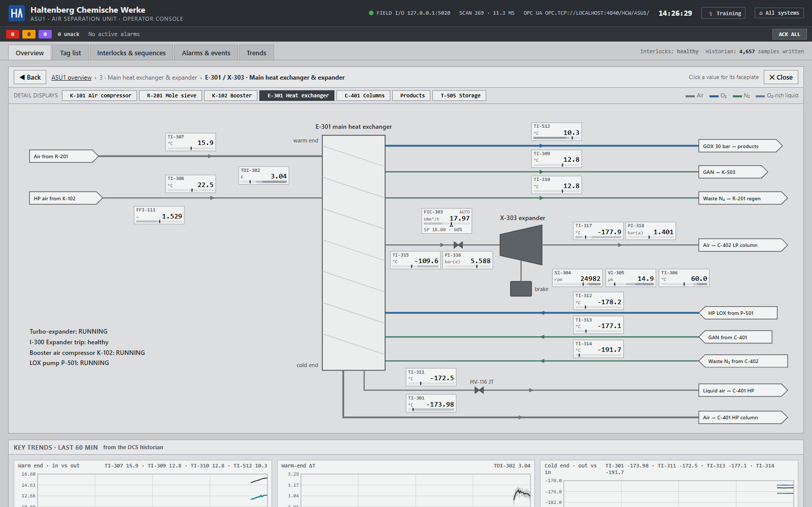

# HCW Haltenberg — ASU1 simulator & DCS

> **Disclaimer.** This code is part of the [IT/OT Academy](https://itot.academy), offered by
> [The IT/OT Insider](https://itotinsider.com). It is a generated, vibe-coded system made **only for
> demo purposes**. It may not be used for anything other than demonstration or training: not in
> production, not connected to real equipment, and not as the basis for any real control, quality
> or maintenance decision.
>
> Its main purpose is to explain the **classic process-industry stack**: field I/O over raw Modbus
> TCP, a DCS that turns it into modelled controller tags, a built-in historian, and OPC UA as the
> interface IT-side clients (here Node-RED) consume.

A demo plant for **Haltenberg Chemische Werke (HCW)**: a Linde-type **Air Separation Unit**
(~1,000 t/d O₂, ~145,000 Nm³/h air) simulated in real time, controlled by a small but complete
**DCS** with a **built-in historian**, which exposes its data over **OPC UA**.

The process model and control strategy follow `linde air seperation research.md`.

**Never been on a production site?** Read [New here? Plant automation in brief](#new-here-plant-automation-in-brief)
first: what a DCS, Modbus, an interlock and a trip are, and a 15-minute first tour.

## Easiest way to start
Open Claude Code in this directory and run the following prompt:
```
read the CLAUDE.md file and README.md file and set up the environment
```

## Prerequisites

- Docker Desktop (or Docker Engine + Compose v2)
- Free host ports: **8110** (DCS console), **8111** (instructor station), **4840** (OPC UA),
  **5020** (Modbus TCP), **1880** (Node-RED)

## Start

```bash
docker compose up -d --build
```

Then open the hub at **http://localhost:8110**.

| What | Where |
|---|---|
| Hub (all systems) | http://localhost:8110 |
| DCS operator console | http://localhost:8110/operator |
| Historian trends | http://localhost:8110/operator#trends |
| Detail display (e.g. the columns) | http://localhost:8110/operator#detail/C-401 |
| Instructor station (fault scenarios) | http://localhost:8111 |
| OPC UA endpoint | `opc.tcp://localhost:4840/hcw/asu1/` (anonymous, no security) |
| Modbus TCP field I/O (raw) | `localhost:5020`, unit 1 |
| Node-RED (OPC UA client flows) | http://localhost:1880 |
| 15-min averages (CSV, written by Node-RED) | `exports/asu1_twa_15min.csv` |

## New here? Plant automation in brief

This section is for people who have never set foot on a production site. It explains just enough
to find your way around the rest of this README and the screens.

### What ASU1 does

Air is 78 % nitrogen and 21 % oxygen. ASU1 compresses air, cleans out water and CO₂, and cools it
to about −175 °C until part of it turns liquid. A distillation column then separates it: oxygen
boils at −183 °C and nitrogen at −196 °C, so nitrogen rises to the top and liquid oxygen collects
at the bottom. The products go by pipeline ("header") to other plants on the site: oxygen to an
ethylene-oxide plant and an acetylene plant, nitrogen to the whole site for purging and blanketing
tanks. Tanks of liquid oxygen and nitrogen are the backup: if ASU1 stops, pumps and vaporizers turn
tank liquid back into gas, so the customers don't notice.

The process is a means to an end here. ASU1 exists to produce realistic plant data, and to show
how that data travels from a sensor to an IT system.

### The layers, from sensor to IT

```
 plant (simulated)       sensors measure, valves and motors act
     │ Modbus TCP        raw numbers in numbered registers: no names, no units
 DCS                     reads every second, controls, alarms, protects
     ├─ historian        stores every value over time
     ├─ operator console the screens the operator works with
     └─ OPC UA           the standard door for IT systems: names, units, quality, history
           │
      Node-RED           an IT-side client: 15-minute averages → CSV
```

In a real plant each layer is a separate box, often from a different vendor and owned by a
different team. Here each is a container. The direction matters: the operator controls the plant
through the DCS, and IT systems only *read* from the DCS. Nothing from the IT side writes back.

### Words you will meet

| Term | What it means | Where to see it here |
|---|---|---|
| **Field device** | Out in the plant: a *transmitter* (sensor) measures a flow, pressure, temperature…; an *actuator* (control valve, motor) acts | The plant container plays all of them |
| **Modbus TCP** | An old, simple and very common protocol between devices. A device is a table of numbered registers, and a client asks "give me registers 100 to 131". There are no names, units or validity flags: you need a separate document, the *register map*, to know that register 100 is the air flow | Instructor station, [inventory/field.json](inventory/field.json) |
| **DCS** | *Distributed Control System*: the plant's control computer. It reads every measurement each second, runs the control loops, raises alarms, enforces interlocks, records history and gives the operators their screens | `dcs` container, operator console |
| **Tag** | The DCS name for one measurement or control loop, e.g. `FIC-101`. See *Reading a tag name* below | Tag list tab |
| **PV / SP / OP** | *Process value* (what is measured), *setpoint* (what we want), *output* (how far the controller opens its valve, in %) | Every data block and faceplate |
| **Control loop (PID)** | A controller compares PV with SP and moves its OP until they match, like cruise control in a car. ASU1 has 19 | Faceplate (click a value) |
| **Mode** | **MAN**: the operator sets the OP by hand. **AUTO**: the controller follows the operator's SP. **CAS** (cascade): another controller sets the SP | Faceplate |
| **Cascade, split range** | One controller drives others. PIC-502 holds the oxygen header pressure: it tells FIC-501 how much oxygen to send, and if that isn't enough, the backup vaporizer FIC-507 takes over the top of its output range | `products` detail display |
| **Alarm** | A value past a limit: **H / L** (high / low, a warning) or **HH / LL** (high-high / low-low, serious). Priority 1 (red, act now) to 3 (violet). The operator *acknowledges* it ("seen"); it clears only when the value is back | Alarms tab, red/amber badges |
| **Interlock** | Automatic protection: "if this goes wrong, stop that machine". It acts on its own and the operator can't override it. ASU1 has seven, I-100 to I-506 | Interlocks tab |
| **Trip** | What an interlock does when it fires: stop the machine at once and put its valves in a safe position. A trip *latches*: it stays tripped until someone resets it | Interlocks tab, event journal |
| **First-out** | The cause that tripped first. When ten alarms arrive at once, this is the one that tells you why | Interlocks tab |
| **Reset** | Clears a trip, and is only allowed once its cause is gone. It doesn't restart anything: that is a separate, deliberate start | Interlocks tab |
| **Parent interlock** | A trip that takes others with it. When the main air compressor trips (I-100), the expander, booster, LOX pump and nitrogen compressor trip too. Children are reset after their parent | Interlocks tab |
| **Permissive** | A condition that must be true before a machine may start, e.g. the LOX pump needs the booster running and enough liquid in the column sump | Start buttons, Interlocks tab |
| **Line-up** | Putting every loop back in its normal mode after a start (**Normal line-up** button) | Interlocks tab |
| **ESD** | Emergency shutdown: one button that trips the whole unit | Interlocks tab |
| **Sequence** | A step program. KS-201 switches the two mole-sieve beds every 4 hours | R-201 detail display |
| **Historian** | A database of values over time. It only stores a value when it has changed noticeably (*exception reporting*), which saves a lot of space | Trends tab, `data/historian.db` |
| **Quality** | Every value carries a status: *Good*, *Bad* (e.g. the link to the plant is down) or *not applicable*. Check it before you use the number | Magenta values, OPC UA status codes |
| **OPC UA** | The modern standard for reading plant data. Unlike Modbus it has a browsable tree with names, units, ranges, timestamps, quality and history | `opc.tcp://localhost:4840/hcw/asu1/`, Node-RED |
| **HMI, faceplate** | *Human-machine interface*: the operator's screens. A faceplate is the small window for one tag, opened by clicking its value | Operator console |
| **Instructor station** | The simulator's control panel, where a trainer starts faults. The DCS can't see the faults, only their effects, just like in a real plant | http://localhost:8111 |

### Reading a tag name

`FIC-101` is a **F**low **I**ndicating **C**ontroller in area **1**, loop **01**.

- **First letter, what is measured:** F flow, P pressure, T temperature, L level, A analysis
  (purity), S speed, V vibration, J power, Z position.
- **Next letters, what it does:** I indicator, C controller, D difference, Y calculated. `FFI` is a
  flow ratio, `KPI-701` a performance figure.
- **The number:** the first digit is the process area, from 1 (air compressors) to 7 (energy). The
  Modbus addresses follow the same areas.
- **Equipment** has its own letters: K compressor, P pump, E heat exchanger or vaporizer,
  C column, R adsorber vessel, T tank, X expander. Interlocks are `I-…`.

So `TI-512` is a temperature indicator in area 5 (products), and `LIC-404` a level controller
in area 4 (the columns).

### What a trip looks like

Take the instructor scenario **MAC bearing degradation**:

1. A bearing in the main air compressor starts to wear. Its vibration, VI-105, creeps up.
2. At 7.1 mm/s it crosses its **H** limit: an amber priority-2 alarm. The operator acknowledges it
   and should call maintenance.
3. At 11 mm/s it crosses **HH**: interlock **I-100** trips. The compressor stops, and its child
   interlocks stop the expander, booster, LOX pump and nitrogen compressor.
4. The oxygen and nitrogen headers start to lose pressure, but their controllers open the backup
   vaporizers. The customers keep their gas, now from the tanks.
5. The Interlocks tab shows I-100 with first-out `VI-105 HH`. Once the compressor has stopped the
   cause is gone, so I-100 can be reset. In real life you would now repair the bearing; here the
   instructor stops the scenario. Then the unit is restarted step by step
   ([Restart after a trip](#restart-after-a-trip)).

Every step of this lands in the historian and on OPC UA: alarms, the trip, the falling flows, the
backups taking over. That is the data you will work with.

### A first tour (15 minutes)

1. Open the hub at http://localhost:8110 and go to the **DCS operator console**.
2. Switch on **🎓 Training** and step through the process with ▶.
3. Click the value of `FIC-101` (the air flow) to open its faceplate: PV, SP, OP, mode and a trend.
4. Click the column on the overview to open the **C-401** detail display. Back and Close take you
   back.
5. Open the **instructor station** (http://localhost:8111) and start **GAN compressor K-503 motor
   trip**.
6. Back in the console, watch the **Alarms** tab (`I-503.TRIP`), and in **Trends** the nitrogen
   header PIC-504 dip while the LIN backup FIC-508 takes over.
7. Recover: on the **Interlocks** tab reset I-503, start the GAN compressor and, once it runs,
   press **Normal line-up**. FIC-508 winds down as K-503 takes the header back.

## Screenshots

**Hub** — one page linking every system, grouped by ISA-95 level.


**DCS operator console — process overview.** ISA-101 style: grey by default, colour only for
alarms. Click any value to open its faceplate.


**Detail displays (ISA-101 level 3)** — click equipment on the overview, or use the
*Detail displays* bar, for one display per unit. Here the double column and main condenser, with a
live boiling-point scale: measured column temperatures against the boiling points at column
pressure.


The mole-sieve display shows both beds, the valve line-up commanded by the KS-201 sequence and the
step progress.


The heat-exchanger display shows every stream through E-301 with its temperature at both ends,
and the expander's inlet and outlet. The values come from one heat balance, so they agree with each
other.



**Tag list and controller faceplate** — every DCS tag with PV, SP, output and mode. The faceplate
switches MAN/AUTO/CAS, changes setpoints and shows a 30-minute trend.


**Interlocks & sequences** — I-100 (ASU shutdown) and I-300 (expander trip) with their causes,
equipment start/stop, ESD, and the KS-201 mole-sieve bed switching sequence.


**Alarms & events** — alarm summary with acknowledge, and the event journal stored in the
historian.


**Historian trends** — up to 8 points, 15 min to 7 days. Here: the PPU cycle compressed to
5 min per bed: CO₂ at the PPU outlet, regeneration gas temperature, bed ΔP and valve stroke time over three bed switch-overs.


**🎓 Training overlay** — walks students through the process step by step, with live values from
the DCS.


**Instructor station** — the simulator side of the glass: PPU time compression, fault scenarios,
the plant's hidden ground truth and the raw Modbus register map.


**Node-RED** — OPC UA client flow: subscribe to the DCS, compute 15-minute time-weighted averages,
append them to a CSV.


Screenshots are taken with headless Chrome. Deep links select each view without clicking:
`/operator#overview|tags|ilk|alarms|trends`, `#detail/C-401` (a detail display), `?tag=PIC-502` (faceplate),
`?training=1&step=1`, and `?trend=AI-202.PV,TIC-204.PV&range=15` (trend points and window in
minutes).

## Architecture

```
plant container                         dcs container
┌──────────────────────────┐  Modbus   ┌────────────────────────────────────┐   OPC UA
│ ASU process model        │   TCP     │ 1 s scan                           │  :4840
│ (6 blocks, 0.5 s step)   │◄─────────►│ 19 PI controllers (cascade, ratio, ├──────────► agents,
│ instructor station :8111 │  :5020    │   split range, override)           │            UaExpert,
│ fault scenarios (hidden) │           │ 7 interlocks (I-100 … I-506)       │            IT systems
└──────────────────────────┘           │ PPU sequence KS-201                │
                                       │ alarms (state-based)               │
                                       │ historian (SQLite) ── data/        │
                                       │ operator console :8110             │
                                       └────────────────────────────────────┘
                                                                                     │ OPC UA
                                                                            nodered container
                                                                            subscribe → 15-min
                                                                            TWA → exports/*.csv
```

- The **plant** knows nothing about control. It reads valve positions and run commands from its
  Modbus registers and writes raw transmitter values back, exactly like a remote I/O rack.
- The **DCS** turns those raw registers into tags with units, ranges, modes, alarms and history.
  That modelled view is the only one exposed over OPC UA.
- **Fixed Modbus addresses per process area:** the area is the first digit of the tag number.
  - **Registers:** area *n* uses *n*×100 … *n*×100+99, so FT-101 is at input register 100, FT-501 at 500 and the heartbeat HB-900 at 900.
  - **Discrete inputs and coils:** area *n* uses *n*×10 …, so YS-101 is at 10.
  - **Adding a point:** it goes at the end of its area. An address never changes, and gaps are normal.
  - **Reading:** the DCS reads one area per request. The plant refuses a read of more than 125 registers, like a real device.
  - **Where to look:** the instructor station and [inventory/field.json](inventory/field.json) list the full map.
- **Fault scenarios** are started on the instructor station and never published. The DCS, the
  historian and any OPC UA client only see the process respond.

## OPC UA

- Namespace `urn:haltenberg:hcw:asu1:dcs`, browse `Objects / HCW / Haltenberg / ASU1`.
- One folder per process block, one object per DCS tag.
  - `PV`, `SP` and `OP` are `AnalogItemType` variables with `EngineeringUnits` and `EURange`.
  - `Mode` and `AlarmState` are strings.
- Also under `ASU1`: `Equipment`, `Interlocks`, `Diagnostics`. The `KS-201` sequence sits in
  `FrontEndPurification`.
- String NodeIds, e.g. `ns=2;s=HCW.ASU1.FIC-101.PV`.
- Values carry the DCS scan time as `SourceTimestamp`. They turn `BadNoCommunication` when the
  field link is lost.
- A calculated value that doesn't apply at the moment reads `BadOutOfService`, live and in history: the specific power KPI-701 and the booster ratio FFI-111 while P-501 delivers no real GOX, e.g. after a trip. Filter on the status code, not on the value.
- `PV`/`SP`/`OP` are `Historizing`. **HistoryRead (raw)** is answered from the DCS historian.
- Read-only: no OPC UA client can change the process (yet).

## Node-RED: OPC UA → 15-minute averages → CSV

The `nodered` container is the official Node-RED image with `node-red-contrib-opcua` installed
into it. It is an ordinary OPC UA *client* of the DCS, like any IT system would be. The
pre-loaded flow **OPC UA → 15-min TWA → CSV** (`nodered_data/flows.json`):

1. Subscribes to six tags in one subscription: `FIC-101`, `FIC-501`, `PIC-502`, `AI-601`,
   `AI-202` and `KPI-701` (`.PV`). The server pushes a value whenever it changes, sampled every 1 s.
2. Computes a **time-weighted average** per 15-minute window. Each value counts for as long as
   it was valid, until the next change (sample-and-hold). A plain average of the notifications
   would over-weight busy periods.
   - Bad-quality time (e.g. `BadNoCommunication`) is left out.
   - The `coverage_pct` column shows how much of the window had good data, as the lowest
     value over all the tags.
3. Appends one row per window to `exports/asu1_twa_15min.csv` (a host folder). The header is
   written when the file is new.

Notes:
- **First row:** it appears at the next quarter-hour. The first window is usually partial, so
  its coverage is below 100 %.
- **Empty KPI cell:** the specific power (`KPI-701`) has no value while no oxygen is produced,
  so its cell stays empty.
- **Adding a tag:** add a line in the **Tags to subscribe** function node.
- **Quick demo:** use 1-minute windows with `TWA_WINDOW_MINUTES=1 docker compose up -d nodered`.

## Training overlay (operator console)

**🎓 Training** in the operator console header explains the process to students. It:
- Dims the overview except for one process step and numbers the steps ①–⑦.
- Shows a card with a plain-language explanation and what that step is doing **right now**,
  e.g. which bed is heating and to what temperature, or whether the vaporizer is helping out.
- Lists the tags worth watching; clicking one opens its faceplate.

How to use it:
- Step with ◀ ▶ (or the arrow keys) or click a numbered circle. Esc closes it.
- Deep link: `/operator?training=1&step=2`.
- Like the rest of the console, it is built only from DCS data. It never reveals the
  instructor's hidden scenarios.

## Detail displays (operator console)

The overview (ISA-101 level 2) shows the whole unit. Each unit also has a **detail display**
(level 3) with every stream and instrument of that unit:

| Display | Covers |
|---|---|
| `K-101` | Intake filter, main air compressor, antisurge recycle, C-102 aftercooler |
| `R-201` | Mole-sieve beds A/B, E-204 regeneration heater, KS-201 sequence panel |
| `K-102` | Booster air compressor, its ratio to the pumped LOX (internal compression) |
| `E-301` | Main heat exchanger: every stream's temperature at both ends; X-303 expander inlet / outlet temperature and pressure |
| `C-401` | HP / LP columns, E-404 main condenser, P-501 LOX pump, boiling-point scale |
| `products` | GOX and GAN headers, consumers, K-503 GAN compressor, PIC-502 / PIC-504 split ranges |
| `T-505` | LOX / LIN tanks, backup pumps P-505 / P-506, backup vaporizers E-507 / E-508 |

How to use them:
- Open one by clicking the equipment on the overview, from the *Detail displays* bar, or with a
  direct link such as `/operator#detail/E-404` (any equipment tag of a display works).
- The arrows at the edge of a display are links: follow a stream from display to display.
- **◀ Back** returns to the previous display (the browser's Back button works too). **✕ Close** or
  Esc returns to the overview.
- Values, faceplates, alarms and trends behave exactly as on the overview.
- New calculated tags on the column display: `TY-411` (N₂ condensing temperature at HP
  pressure), `TY-412` (O₂ boiling temperature at LP pressure), `TY-413` (N₂ boiling temperature
  at LP pressure). They are historized and published over OPC UA like every other tag.

## Time compression (instructor station)

The **PPU bed cycle** slider on the instructor station runs from *real time* (4 h per bed) to
*really fast* (5 min per bed). Ticks are provided for 2 h, 1 h, 30, 15 and 10 min.
- **What scales:** bed loading, the regeneration heater and the DCS's KS-201 sequence timer all
  scale together. The rest of the ASU stays in real time.
- **Path to the DCS:** the plant pushes the new value to the DCS as a KS-201 parameter. It
  appears in the event journal and on OPC UA as `KS-201.CycleTime`.
- **Persistence:** the DCS stores it in `data/dcs_state.json`, and the plant follows the DCS
  after a restart.

## Historian

- SQLite at `data/historian.db` on the host, with exception reporting:
  - **Deadband:** store a value when it moves more than 0.25 % of span.
  - **Heartbeat:** store at least every 60 s.
  - **Retention:** 14 days.
- Bad-quality periods are stored as gaps, with their reason: no communication, or not applicable (see OPC UA).
- The alarm and event journal (alarms, trips, sequence steps, operator actions) lives in the
  same database.
- Controller modes, setpoints and sequence state are checkpointed to `data/dcs_state.json`, so a
  DCS restart resumes where it was.

## Scenarios (instructor station)

| Scenario | What the operator sees |
|---|---|
| EO plant demand step | GOX header drops; the pumped LOX runs into its load limit FY-501 and the backup vaporizer covers the rest. Purity sits at the spec edge until the air load is raised |
| Acetylene burner trip | Sharp O₂ demand drop for 15 min |
| N₂ purge campaign | GAN demand +10 kNm³/h: K-503 load and power (JI-514) go up |
| MAC motor trip | I-100 ASU shutdown: expander, booster, LOX pump and GAN compressor trip with it. The backups hold both headers: E-507 the GOX header (~23 h from a 65 % tank), E-508 the GAN header (~14 h from 60 %) |
| MAC bearing degradation | VI-105 / TI-106 creep up over ~40 min → H alarm → HH trip |
| MAC impeller fouling | Same air, more MW: KPI-701 specific power drifts up |
| DCAC water carry-over | CO₂ breakthrough at the PPU outlet ~35 min in → 10 ppm trip unless beds are switched |
| Regeneration heater fault | KS-201 "regeneration incomplete", breakthrough one cycle later |
| Booster motor trip | I-110 → I-500: without booster air the pumped LOX can't vaporize, so P-501 trips; vaporizer takes the header. Without the cold LOX stream the E-301 cold end warms (TI-301). Restart within ~10 min or the reboiler floods (LIC-404 HH → I-100) |
| LOX pump cavitation | PI-511 unsteady and falling over ~5 min → LL → I-500; the E-301 cold end then warms (TI-301 H). The suction re-cools in ~5 min, then P-501 can be restarted |
| GAN compressor K-503 trip | I-503: the GAN header dips to ~7.6 bar(g) while PIC-504 hands over to the LIN backup (P-506 / E-508). The column vents the GAN it no longer sends out |
| LOX backup pump P-505 trip | I-505 alarm "no GOX backup" and nothing else, until the next P-501 or ASU trip: then the GOX header collapses. Reset I-505 and restart P-505 |
| Expander loss of loading | Overspeed trip. Without the expander draw E-301 gets out of balance: the warm-end ΔT closes to ~0 and the cold end warms (TI-301 H after ~20 min); the reboiler level drains over hours |
| MHE fouling | Warm-end ΔT creeps up (H after ~70 min), the cold end warms with it |
| Hydrocarbon event | Hydrocarbons in the intake rise six-fold. The pumped LOX flushes them out with the product, so AI-603 only becomes a problem while P-501 is down |
| Heatwave | Less MAC capacity, more power, more water load on the PPU |

## Oxygen product: internal compression

GOX leaves ASU1 at pipeline pressure without an oxygen compressor (research §3, block 5):

- **P-501 LOX pump** draws liquid oxygen from the LP sump and pumps it to ~33 bar(g) (PI-511).
- The pumped LOX **boils in E-301** against **booster air**: K-102 compresses ~30 % of the clean
  air to ~60 bar(a) (FIC-111, PI-112, JI-113, VI-114); it condenses on the other side and goes
  through the JT valve HV-116 into the HP column as liquid air.
- **Cross-limiting ratio control**, as for burner air/fuel: FIC-111's setpoint is the ratio (1.52)
  × the higher of LOX flow and LOX demand, so the booster leads on increase. The demand counts only up
  to the load limit FY-501: booster air for oxygen the pump won't deliver has no LOX to condense
  against (found with the E-301 heat balance in step 3: at reduced air it warmed the cold end by 7 K). FIC-501's setpoint is
  capped at what the measured booster air can vaporize, so the LOX follows. FFI-111 shows the actual
  ratio; the operator sets it on the FIC-111 faceplate (1.35–2.0).
- **TI-512**, the GOX temperature leaving E-301, is the safety variable: too little booster air →
  cold (eventually liquid) oxygen towards the carbon-steel header → LL −25 °C trips **I-500**.
- **Load limit FY-501** = 0.208 × air (FIC-101) − LOX to storage (FI-408), plus an allowance for a
  sump above its setpoint. FIC-501's setpoint is capped there (status `CAP`, "LOAD LIMIT"): the pump
  can't take more oxygen than the air brings in. More demand → the backup vaporizer covers it and
  the operator raises the air. Without it, the EO demand step pumped the sump down and crashed
  purity to 94 % (found while testing step 2b; a gap in step 2a).
- **LIC-415**, a reboiler low-level override, limits FIC-501 below 45 %. The column can't be
  pumped empty when the header asks for more than it makes; the backup vaporizer covers the
  difference.

## Nitrogen product and backup supply

- **K-503 GAN compressor.** GAN leaves the HP column top at ~5.3 bar(a), is warmed in E-301 and
  compressed to the 8 bar(g) site grid. FIC-503 drives its inlet guide vanes (FV-503). Minimum flow
  10 kNm³/h (FIC-503 SP low limit); it surges below ~8 kNm³/h (VI-515). Also PI-513 discharge
  pressure and JI-514 motor power. It needs the MAC running and PI-401 ≥ 4 bar(a) to start.
- **Backup pumps P-505 (LOX) and P-506 (LIN)** lift tank liquid to header pressure for the
  vaporizers **E-507** (GOX header, FIC-507) and **E-508** (GAN header, FIC-508, up to 40 kNm³/h).
  They are *kept cold*: running all the time on minimum-flow recirculation (PI-516 / PI-517 show
  the shut-off head), so they deliver as soon as their valve opens. They are not tripped by I-100:
  the backup has to survive an ASU trip. I-505 / I-506 trip them on tank level LL (10 %).
- **Split range** on both headers: PIC-502 → FIC-501 (OP 0–80 %) / FIC-507 (80–100 %), and now
  PIC-504 → FIC-503 (0–80 %) / FIC-508 (80–100 %).
- **Trip handover (feed-forward).** When I-500 or I-503 trips, the header master's OP jumps at
  once to where the backup vaporizer takes over the lost flow, instead of waiting for the pressure
  to fall far enough. GOX header minimum on a booster trip: 27.8 bar(g) (was 23.8, below LL);
  GAN header on a K-503 trip: ~7.6 bar(g).
- **Handback.** When FIC-501 / FIC-503 go back to CAS after a restart, the master is re-initialised
  so the restarted supply's setpoint equals the total flow now delivered; the vaporizer winds
  down as it takes over (no pressure bump).
- **Specific power** KPI-701 = (MAC + booster + GAN compressor power) ÷ GOX, ≈ 0.55 kWh/Nm³
  (H alarm 0.60).

## Main heat exchanger E-301: a simple heat balance

Every stream through E-301 has a temperature at both ends, and the expander X-303 has its inlet and
outlet temperature and pressure:

| | Warm end (top) | Cold end (bottom) |
|---|---|---|
| Main air | TI-307 in, ≈ 15 °C | TI-301 out, ≈ −174 °C → HP column |
| Booster air (~60 bar) | TI-308 in, ≈ 22 °C | TI-311 out (liquefied), ≈ −172 °C → HV-116 |
| Pumped LOX → GOX | TI-512 out, ≈ 10 °C | TI-312 in, ≈ −178 °C |
| GAN | TI-309 out, ≈ 12 °C → K-503 | TI-313 in, ≈ −177 °C |
| Waste N₂ | TI-310 out, ≈ 12 °C → PPU regeneration | TI-314 in, ≈ −192 °C |
| Expander side draw | | TI-315 / PI-316 in ≈ −110 °C, 5.6 bar(a); TI-317 / PI-318 out ≈ −178 °C, 1.4 bar(a) |

The plant model closes an **enthalpy balance** over E-301 at every step, with deliberately simple
assumptions: ideal gases with one constant cp (1.30 kJ/Nm³·K), constant heats of vaporisation, no
heat leak into the exchanger, a clean exchanger.
- **Inlets** come from upstream: the PPU, the booster aftercooler, the column streams at their
  boiling points.
- **Outlets** follow from design approaches: 3 K at the warm end, −174 °C at the cold end.
- **What doesn't balance** shifts the whole temperature profile, through the exchanger's metal
  (~10 min). Too much warm flow (booster air without LOX, no expander draw) warms it: the warm-end
  ΔT closes and the cold end warms. Too much cold flow cools it: the warm-end ΔT opens.
- **One calibrated number:** the heat the 60 bar booster air releases while it liquefies
  (~200 kJ/Nm³), chosen so the design point balances.
- **The expander:** an isentropic drop with 85 % efficiency, fitted to −110 → −178 °C. A loss of
  loading extracts less work, so the outlet is warmer.

So the data is consistent: TDI-302 = TI-307 − TI-310, and the balance recomputed from the OPC UA
tags closes within 2 % (a test checks both). The refrigeration balance that drives the cold box and
the sump levels is unchanged.

Alarms (no trips): TI-315 H (warm expander inlet), TI-317 L (close to the dew point: liquid in the
expander) and H (too little work extracted).

## Restart after a trip

1. Interlocks tab: **Reset I-100**, then I-300, I-110, I-503 and I-500. A child interlock can only
   be reset after its parent (I-100 → I-300 / I-110 / I-503, I-110 → I-500). The backup pumps
   P-505 / P-506 keep running through an ASU trip; the vaporizers hold both headers meanwhile.
2. **Start** the main air compressor. It starts in MAN on minimum guide vanes.
3. Once it is RUNNING, press **Normal line-up**, then raise the FIC-101 setpoint to 145.
   - It ramps at 1.45 kNm³/h per minute by default; the ramp rate is set on the faceplate.
4. Start the expander. Once it is RUNNING, press **Normal line-up** again and set the FIC-303
   setpoint to 18.
5. Start the **booster K-102** (needs the MAC running). Once it is RUNNING, press **Normal line-up**:
   FIC-111 goes to CAS and follows the pumped LOX in ratio.
6. Start the **LOX pump P-501** (needs the booster running and LIC-404 ≥ 40 %). It starts on part
   flow in MAN. Once it is RUNNING, press **Normal line-up**: FIC-501 returns to CAS under the GOX
   header pressure. Line-up skips loops whose equipment isn't running yet and says so.
7. Start the **GAN compressor K-503** (needs the MAC running and PI-401 ≥ 4 bar(a)). Once it is
   RUNNING (~25 s), press **Normal line-up**: FIC-503 takes the GAN grid back from the LIN backup.
8. Purity takes ~1 h to recover.

After a booster or LOX pump trip alone, only steps 5–6 are needed, but be quick: with the pump
down the oxygen stays in the reboiler sump, which floods in ~10 min (LIC-404 HH trips the ASU).
After a K-503 trip alone, only step 7. After a backup pump trip: reset I-505 / I-506, start the
pump (tank level above 10 %) and press **Normal line-up**.

## Configuration

Settings are environment variables in `docker-compose.yml`.

| Variable | Default | Purpose |
|---|---|---|
| `PPU_CYCLE_SECONDS` | `14400` | Initial mole-sieve bed online time, shared by plant and DCS (YAML anchor). Changed at runtime with the instructor's time-compression slider (300–14400 s); the DCS checkpoint then wins |
| `DCS_URL` | `http://dcs:8110` | Plant → DCS link for the cycle-time slider |
| `TWA_WINDOW_MINUTES` | `15` | Node-RED averaging window; override from the shell for a quick demo |
| `TWA_CSV_FILE` | `/data/exports/asu1_twa_15min.csv` | Where Node-RED appends rows (`exports/` on the host) |
| `SCAN_SECONDS` | `1` | DCS scan period |
| `PLANT_HOST` / `PLANT_PORT` | `plant` / `5020` | Where the DCS finds the I/O rack (compose service name, not localhost) |
| `HISTORIAN_DEADBAND_PCT` | `0.25` | Exception deadband, % of tag span |
| `HISTORIAN_MAX_INTERVAL_SECONDS` | `60` | Heartbeat: store at least this often |
| `HISTORIAN_RETENTION_DAYS` | `14` | Purge older samples/events |
| `PUBLIC_OPCUA_ENDPOINT`, `PUBLIC_INSTRUCTOR_URL`, `PUBLIC_MODBUS_ENDPOINT`, `PUBLIC_NODERED_URL` | localhost URLs | Links shown on the hub page |

## Offline tuning

`tools/offline_sim.py` couples the plant model and the DCS control layer directly, without
containers or I/O, and runs hours of plant time in seconds:

```bash
docker run --rm -v "$PWD":/w -w /w python:3.12-slim python tools/offline_sim.py \
  --hours 1.5 --every 300 --scenario eo_demand_step@600 --cmd sp:FIC-101=160@1800
```

`--seed 7` makes a run repeatable.

## Tests

The model will keep growing, and the systems around it must keep agreeing. The tests guard
consistent behaviour and stable interfaces: no tag, register, OPC UA node or API field goes
missing or changes without anyone noticing. They are not there to prove the physics is perfect.

```bash
docker compose run --rm tests                       # everything, ~1 min (builds the test image once)
docker compose run --rm tests python -m pytest -m "not e2e"     # without the end-to-end part
docker compose run --rm tests python tools/inventory.py         # after an intended interface change
```

The test container mounts the working tree, so there is nothing to rebuild after a code change.
It does not touch the running stack. The tests come in four parts:

| File | What it checks | Time |
|---|---|---|
| `tests/test_inventory.py` | The committed [interface inventory](inventory/README.md) still matches the code | 5 s |
| `tests/test_contracts.py` | Every name a layer uses exists in the layer it comes from: Modbus map ↔ plant model ↔ DCS config ↔ OPC UA ↔ operator console, instructor station, Node-RED flow and docs. Hidden faults never reach the DCS side | 8 s |
| `tests/test_behaviour.py` | Plant model + DCS, faster than real time: steady state in spec with no P1/P2 alarm; a signature for every instructor scenario; the restart procedures ([Restart after a trip](#restart-after-a-trip)); permissives, I/O loss, checkpoint, ESD, PPU time compression | 30 s |
| `tests/test_e2e.py` | The real plant and DCS programs over real Modbus: HTTP API, OPC UA browse / values / HistoryRead and the raw registers against the inventory; Bad quality when the plant goes away | 20 s |

**When a test fails:**

- **The inventory test:** an interface changed. If you intended the change, regenerate the inventory and commit it with the change. The PR then shows exactly which tags, nodes or registers changed.
- **A behaviour test:** cause and effect changed. Either fix the regression, or, if the new behaviour is right, update the test and say why in the PR.
- **New instructor scenario:** add its expected effect to `SIGNATURES` in `tests/test_behaviour.py`. A test fails until you do.

The behaviour tests use a fixed seed. Their limits are meant to hold for any seed (seeds 1–44 pass except 37, see CLAUDE.md), so check another one after retuning:

```bash
docker compose run --rm -e HCW_TEST_SEED=3 tests python -m pytest tests/test_behaviour.py
```

## Stop / reset

```bash
docker compose down              # stop
rm data/historian.db* data/dcs_state.json   # wipe history and controller state
rm exports/*.csv                            # wipe the Node-RED averages
```

After pulling a change to `dcs/config.py` (controller tuning, SP limits), remove or rename
`data/dcs_state.json` before `docker compose up -d --build`. The checkpoint restores each loop's
tuning and limits, so otherwise the DCS keeps the old values.

After a change to the Modbus map (`common/iomap.py`), stop the stack first, with `docker compose down`, and only then `docker compose up -d --build`. Also move the checkpoint aside. Otherwise the old DCS runs against the new plant for a few seconds and reads the wrong registers. That's like a real I/O-map mismatch: run feedbacks look lost, the DCS trips the machines, and the checkpoint saves those trips.

## Roadmap and contributing

Plans, ideas and work in progress are tracked in [ROADMAP.md](ROADMAP.md). Propose an idea there,
or claim an item before you start, so people and agents working in parallel don't collide.
