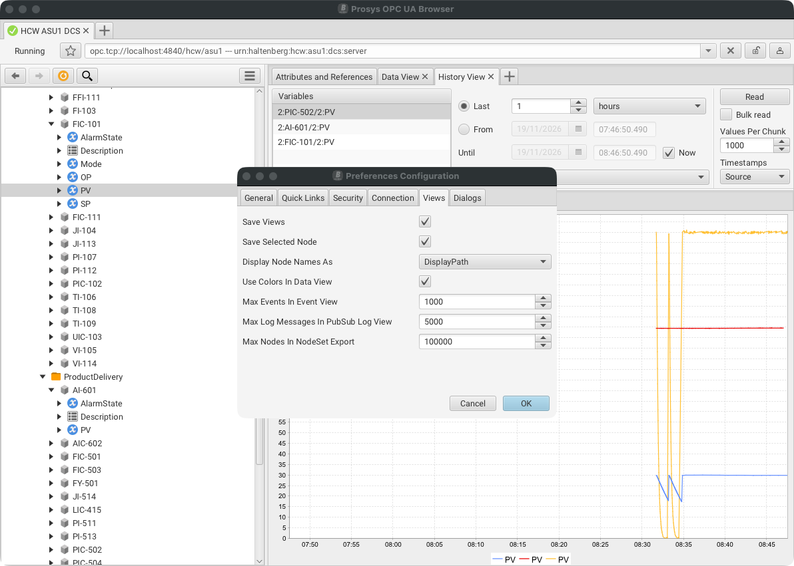
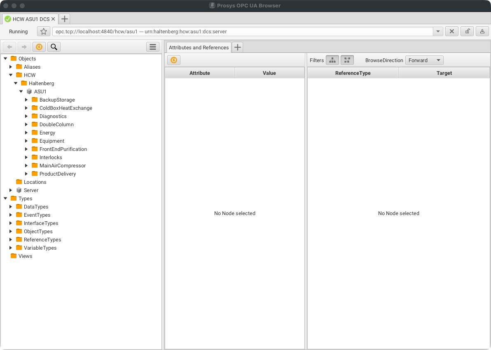
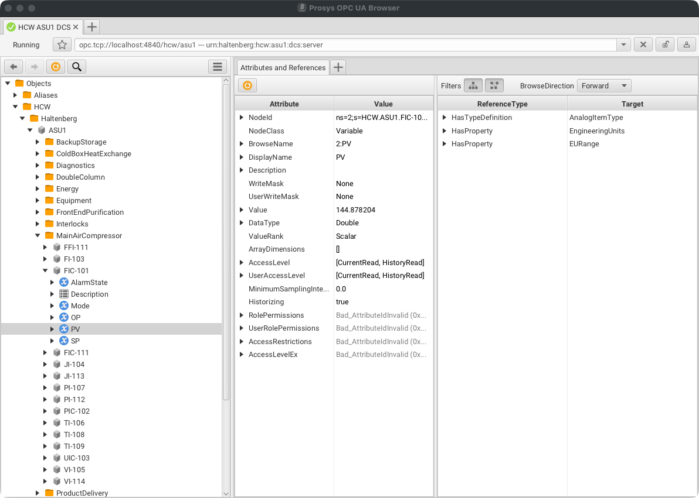
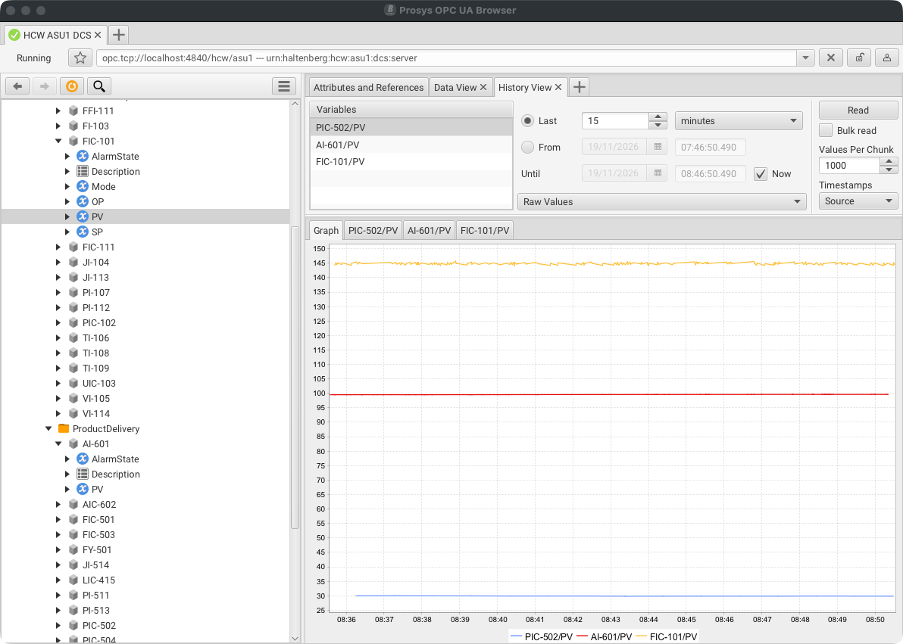
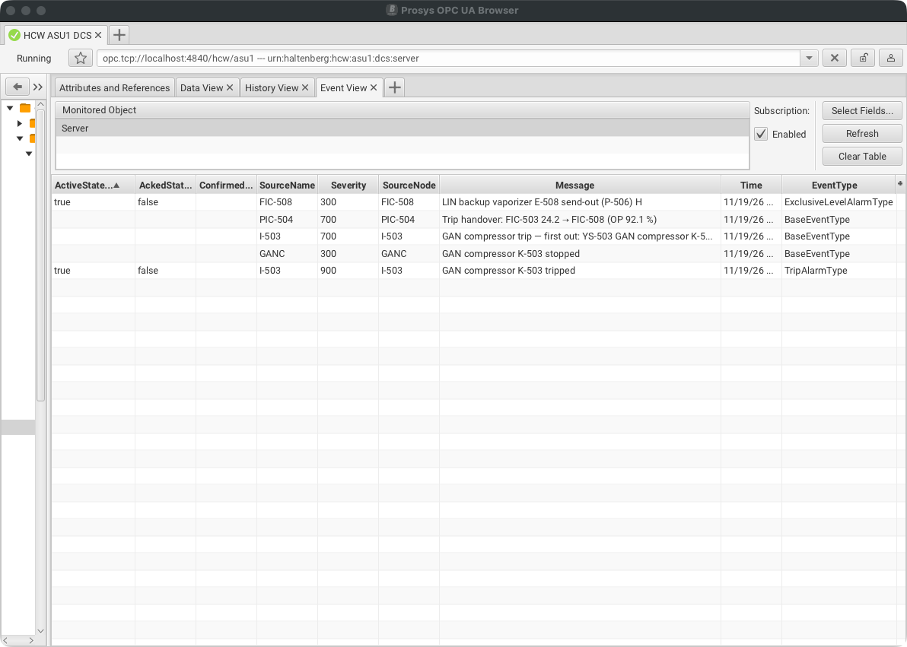
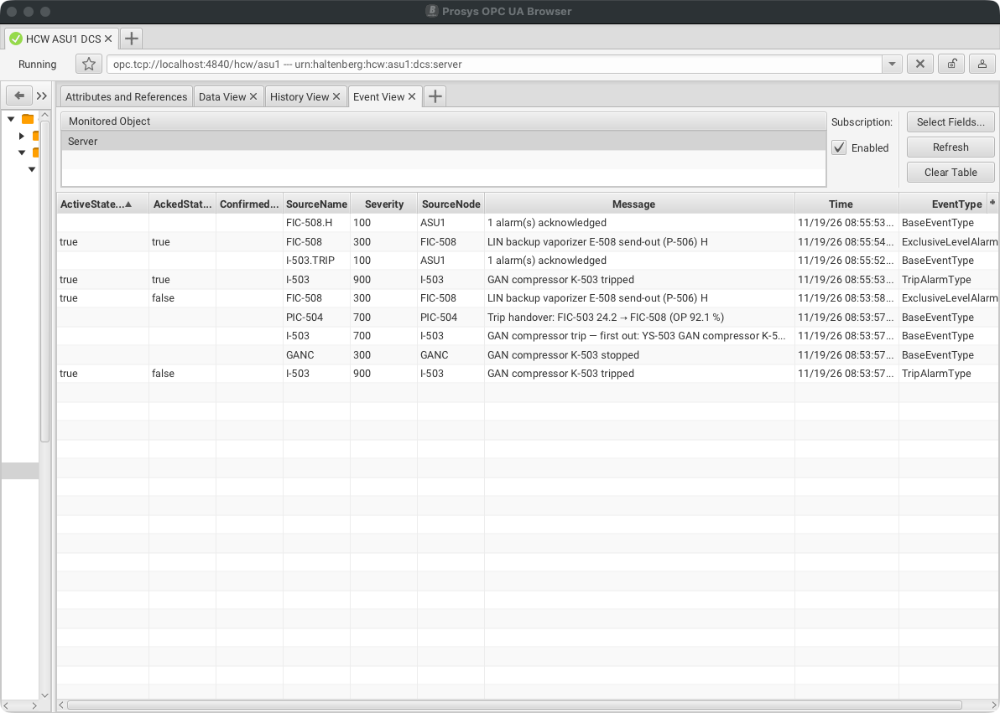

# Browsing the OPC UA servers

Each of the three sites has a DCS with its own OPC UA server. A generic OPC UA client lets you look
inside: browse the address space, read live values with their quality and units, read history
from the historian and follow the alarms. That's what any IT system sees when it connects to the
DCS, before you write a line of code.

This page uses the free **Prosys OPC UA Browser**, which runs on macOS, Windows and Linux.
**UaExpert** (Unified Automation) works the same way, but only on Windows and Linux. The
screenshots are from Haltenberg. For the full reference of the address space see
[Data access](Data-access#opc-ua).

## The endpoints

Start the stack first ([Getting started](Getting-started)). All three servers are anonymous, with
SecurityPolicy None.

| Site | Endpoint | Namespace |
|---|---|---|
| Haltenberg (DE) | `opc.tcp://localhost:4840/hcw/asu1/` | `urn:haltenberg:hcw:asu1:dcs` |
| Port Arden (US) | `opc.tcp://localhost:4841/PortArden/ASU7100` | `urn:hcw-americas:port-arden:asu7100:dcs` |
| Vadhana (IN) | `opc.tcp://localhost:4842/vadhana/asu2` | `urn:hcw-india:vadhana:asu2` |

These are the addresses from your laptop. From another container on the compose network use the
service name instead of `localhost`, e.g. `opc.tcp://dcs:4840/hcw/asu1/`. A second stack with its
own `.env` uses its own ports (see [Configuration](Configuration)).

## Connect

1. Type the endpoint into the address bar at the top and press **→**.
2. Choose Security Mode **None**, then log in **anonymously**.
3. The tab gets a green tick and the status reads **Running**.

**Tip: show the full node names.** By default Prosys names a variable by its BrowseName, so every
value you drag into a view is just called `PV`. Under **Options → Preferences → Views** set
**Display Node Names As** to **DisplayPath**: the views then show `FIC-101/PV`, `AI-601/PV`.



## The address space

Open **Objects → HCW → Haltenberg → ASU1**. There is one folder per process block (from
`MainAirCompressor` through `FrontEndPurification`, `ColdBoxHeatExchange`, `DoubleColumn` to
`ProductDelivery` and `BackupStorage`), plus `Equipment`, `Interlocks`, `Diagnostics` and `Energy`.
Every DCS tag is an object in its block's folder.



Open a controller, e.g. **MainAirCompressor → FIC-101** (the main air flow). It has `PV`, `SP`,
`OP`, `Mode`, `AlarmState` and `Description`. A measurement such as **ProductDelivery → AI-601**
(GOX purity) has no SP, OP or Mode.

## A value and its attributes

Click **FIC-101 → PV**. The **Attributes and References** tab shows what a client gets with the
value:

- **NodeId** `ns=2;s=HCW.ASU1.FIC-101.PV`: the address a program uses to read it.
- **Value** (~145 kNm³/h at design), DataType `Double`.
- **AccessLevel** `CurrentRead, HistoryRead` and **Historizing** `true`: there is history behind it.
- **References:** type `AnalogItemType`, with the properties **EngineeringUnits** (kNm³/h) and
  **EURange** (0–180). Expand **Value** to see the StatusCode (`Good`) and the SourceTimestamp, the
  DCS scan time.



The rows **RolePermissions**, **UserRolePermissions**, **AccessRestrictions** and **AccessLevelEx**
read `Bad_AttributeIdInvalid`. That's not a fault: they are optional attributes from newer versions
of the OPC UA specification that our server (asyncua) doesn't implement. Prosys asks for them anyway.

Watch the StatusCode as well as the value. When the field link to the plant is lost every value turns
`BadNoCommunication`, and a calculated value that doesn't apply at the moment (the specific power
KPI-701 after a trip) reads `BadOutOfService`.

## History

Add a **History View** with the **+** next to the tabs, drag the PVs you want into its
**Variables** list (here FIC-101, AI-601 and PIC-502), choose e.g. **Last 15 minutes**,
**Raw Values**, and press **Read**. The server answers the HistoryRead from the DCS historian: the
same data as the console's trends.



The tabs per variable list the raw samples. They show the historian's **exception reporting**: a
new sample only when the value moves more than 0.25 % of its span, and at least one every 60 s.
After a trip and restart you see the drop and the recovery in the history.

## Alarms and events

Add an **Event View** and drag the **Server** object into **Monitored Object** (or `ASU1`, or a single
block folder). Press **Refresh**: Prosys does a ConditionRefresh and lists the alarms that are active
or unacknowledged right now. In steady state that list is empty, so trip something. The instructor
station's K-503 GAN compressor trip is a good one, because only that compressor trips and the LIN
backup takes over the header:

```bash
curl -s -X POST localhost:8111/api/scenarios/gan_compressor_trip/start
```



Two kinds of rows arrive:

- **Conditions**, with ActiveState and AckedState: the trip of interlock I-503 as a `TripAlarmType`
  (severity 900, P1), and FIC-508.H, the LIN backup vaporizer E-508 sending out, as an
  `ExclusiveLevelAlarmType` (300, P3).
- **Journal events** (`BaseEventType`): K-503 stopped, the I-503 first-out, and the trip handover
  on PIC-504, where the DCS moves the lost GAN flow straight to the LIN backup FIC-508.

Acknowledge the alarms on the [operator console](Operator-console) (the OPC UA alarms are read-only,
so Prosys can't). Each condition then sends a new event with AckedState `true`, and the operator's
action arrives as a journal event "1 alarm(s) acknowledged".



Recover the plant as in the [first tour](Getting-started#a-first-tour-15-minutes): on the
**Interlocks** tab reset I-503, start the GAN compressor and press **Normal line-up**.

## The other two sites

Connect to Port Arden and Vadhana the same way, in a new connection tab (**+** at the top). The
plants are the same, but each DCS presents its data in its own way, which is the starting point of
the [Global sites](Global-sites) demo. The main air flow, FIC-101 at Haltenberg:

| | Haltenberg | Port Arden | Vadhana |
|---|---|---|---|
| Browse path | `HCW/Haltenberg/ASU1/MainAirCompressor/FIC-101/PV` | `PTA_ASU7100/Points/71FC1001/PV` | `VDH_ASU2/02MAA10/02MAA10CF001/XQ01` |
| NodeId | `s=HCW.ASU1.FIC-101.PV` | `s=71FC1001.PV` | `i=1010` (numeric) |
| Unit | kNm³/h | MSCFH (a string variable `EUDESC`) | Nm³/h |

Things to look for:

- **Port Arden:** a flat list of points under `Points`, US units, Mode as a number.
- **Vadhana:** asset codes, a separate object for the measurement (`XQ01`) and the controller,
  numeric NodeIds, and **timestamps in India time labelled as UTC**: live values and history are
  5.5 hours "in the future". In a History View over the last 15 minutes that is easy to miss.
- **Alarms:** the same condition types at every site, under the site's own source names, e.g.
  `71UZ5003` at Port Arden and `02CJA00EZ001` at Vadhana.

The **Site mapping explorer** (http://localhost:8110/mapping) shows every site's nodes side by side,
mapped onto the [Standard data model](Standard-data-model).
