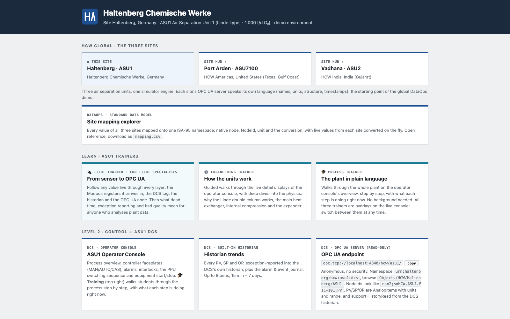

# Getting started

## Easiest way

Open Claude Code in the repository folder and run this prompt:

```
read the CLAUDE.md file and README.md file and set up the environment
```

## Prerequisites

- Docker Desktop (or Docker Engine + Compose v2)
- Free host ports: **8110** (DCS console), **8111** (instructor station), **4840** (OPC UA),
  **5020** (Modbus TCP), **1880** (Node-RED)

## Start

```bash
git clone https://github.com/itotinsider/haltenberg-chemische-werke-uns.git
cd haltenberg-chemische-werke-uns
docker compose up -d --build
```

Then open the hub at **http://localhost:8110**. The plant starts at steady state; it doesn't need
a start-up procedure.

| What | Where |
|---|---|
| Hub (all systems) | http://localhost:8110 |
| DCS operator console | http://localhost:8110/operator |
| Historian trends | http://localhost:8110/operator#trends |
| Detail display (e.g. the columns) | http://localhost:8110/operator#detail/C-401 |
| Trainers (Engineering, IT/OT) | http://localhost:8110/trainer |
| Instructor station (fault scenarios) | http://localhost:8111 |
| OPC UA endpoint | `opc.tcp://localhost:4840/hcw/asu1/` (anonymous, no security) |
| Modbus TCP field I/O (raw) | `localhost:5020`, unit 1 |
| Node-RED (OPC UA client flows) | http://localhost:1880 |
| 15-min averages (CSV, written by Node-RED) | `exports/asu1_twa_15min.csv` |

**Hub** — one page linking every system, grouped by ISA-95 level.



## A first tour (15 minutes)

New to plants? Read [Plant automation in brief](Plant-automation-in-brief) first.

1. Open the hub at http://localhost:8110 and go to the **DCS operator console**.
2. Switch on **🎓 Training** and step through the process with ▶. Want more depth? Each step has
   "Go deeper" links into the [Engineering and IT/OT trainers](Trainers).
3. Click the value of `FIC-101` (the air flow) to open its faceplate: PV, SP, OP, mode and a trend.
4. Click the column on the overview to open the **C-401** detail display. Back and Close take you
   back.
5. Open the **instructor station** (http://localhost:8111) and start **GAN compressor K-503 motor
   trip**.
6. Back in the console, watch the **Alarms** tab (`I-503.TRIP`), and in **Trends** the nitrogen
   header PIC-504 dip while the LIN backup FIC-508 takes over.
7. Recover: on the **Interlocks** tab reset I-503, start the GAN compressor and, once it runs,
   press **Normal line-up**. FIC-508 winds down as K-503 takes the header back.

## Stop / reset

```bash
docker compose down              # stop
rm data/historian.db* data/dcs_state.json   # wipe history and controller state
rm exports/*.csv                            # wipe the Node-RED averages
```

After pulling a change to `dcs/config.py` (controller tuning, SP limits), remove or rename
`data/dcs_state.json` before `docker compose up -d --build`. The checkpoint restores each loop's
tuning and limits, so otherwise the DCS keeps the old values.

After a change to the Modbus map (`common/iomap.py`), stop the stack first with
`docker compose down`, and only then `docker compose up -d --build`. Also move the checkpoint
aside. Otherwise the old DCS runs against the new plant for a few seconds and reads the wrong
registers. That's like a real I/O-map mismatch: run feedbacks look lost, the DCS trips the
machines, and the checkpoint saves those trips.
