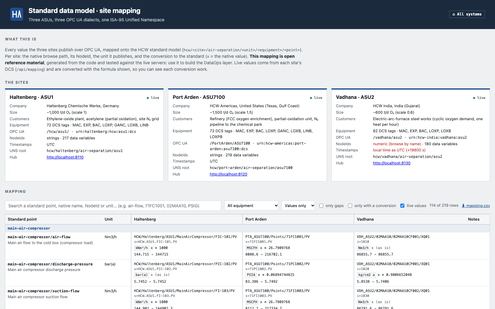
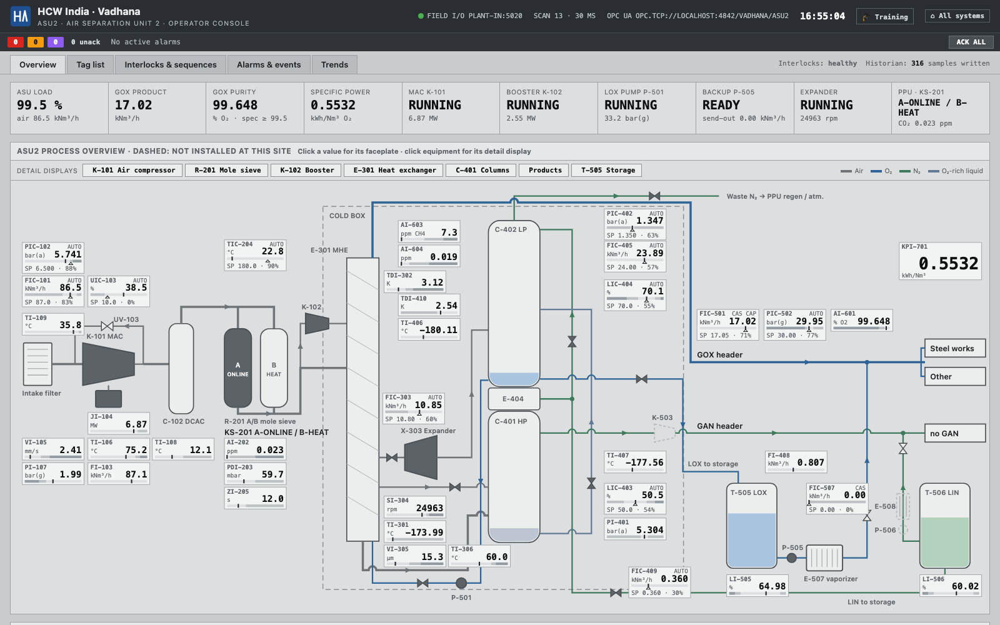
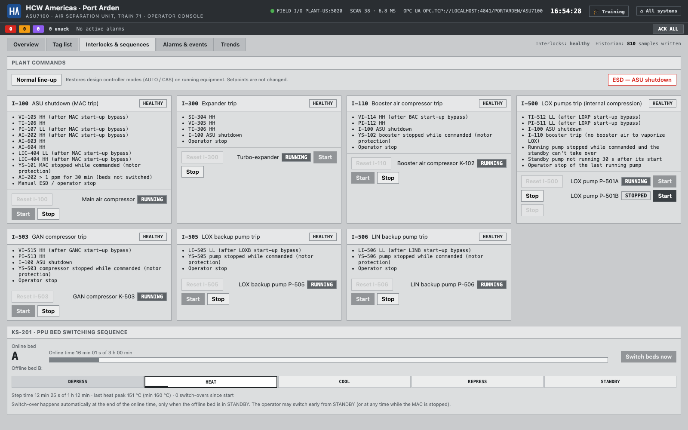

# Global sites

HCW runs three air separation units on three continents. They are the starting point of the
**global DataOps demo**: the same kind of plant, the same kind of data, delivered in three
different shapes. A DataOps layer has to standardise them onto one model: the
[Standard data model](Standard-data-model).

**The mapping of all three sites onto the standard is open reference material** (not an exercise):
the **Site mapping explorer** on every hub (http://localhost:8110/mapping, also on 8120 and 8130)
shows every value of every site side by side: native node, NodeId, unit, the conversion to the
standard, and the live value before and after conversion. The same data is in
[`inventory/uns/mapping.csv`](https://github.com/itotinsider/haltenberg-chemische-werke-uns/blob/main/inventory/uns/mapping.csv)
(a download button on the page) and `inventory/uns/sites.json`.

All three run the same simulator engine (plant model + DCS). What differs per site is set in
[`common/sites.py`](https://github.com/itotinsider/haltenberg-chemische-werke-uns/blob/main/common/sites.py):
its size, climate, customers, some equipment, and above all **how its DCS presents the data over
OPC UA**.

## The three sites

| | **Haltenberg** (DE) | **Port Arden** (US) | **Vadhana** (IN) |
|---|---|---|---|
| Company | Haltenberg Chemische Werke | HCW Americas | HCW India |
| Location | Rhine valley, Germany | Texas Gulf Coast | Gujarat coast |
| Unit | ASU1 | ASU7100 ("Train 71") | ASU2 |
| Size | ~1,000 t/d O₂, 145 kNm³/h air | ×1.5: ~1,500 t/d, 217.5 kNm³/h | ×0.6: ~600 t/d, 87 kNm³/h |
| Climate | 15 °C ± 5 | 24 °C ± 5, humid | 30 °C ± 6, hot |
| Customers | EO plant, acetylene, site N₂ grid | refinery (FCC), POX unit, N₂ pipeline | electric-arc-furnace steel works |
| O₂ demand | steady, slow wander | steady, slow wander | **cyclic**: one furnace heat per hour |
| LOX pumps | P-501 | **P-501A + P-501B** (duty / standby) | P-501 |
| GAN product | K-503 + LIN backup | K-503 + LIN backup | **none** (O₂ only) |
| Mole-sieve bed cycle | 4 h | 3 h | 2 h |
| DCS tags · equipment · interlocks | 72 · 7 · 7 | 72 · 8 · 7 | 62 · 5 · 5 |
| OPC UA style | ISA tags in process blocks | flat point database | asset codes (KKS style) |

### What is the same everywhere

- **The physics:** the same model, at the same design point. A site's `scale` multiplies every
  flow and power (a bigger or smaller plant of the same design). Pressures, temperatures, levels and
  purities stay the same, and so do the dynamics.
- **The control strategy:** the same DCS engine, the same loops (minus those of missing equipment),
  interlocks, KS-201 sequence, alarm philosophy and historian settings.
- **The operator console and the historian** use the engine's tag names (FIC-101 …) at every site.
  The console header names the site; equipment a site doesn't have is drawn dashed.
- **The instructor station:** the same faults, minus those for missing equipment, with the site's
  customer names.

### Process differences

- **Port Arden: standby LOX pump.** When the running pump trips, the DCS starts the other one
  instead of tripping I-500 (automatic changeover). The alarm `LOXPB.AUTOSTART` (or `LOXP.AUTOSTART`)
  says the plant now runs without a spare. The GOX header barely notices. The operator swaps duty by
  starting one pump and stopping the other; stopping the last running pump is a trip, as with one
  pump. Instructor fault: *LOX pump motor trip (duty pump)*.
- **Vadhana: an oxygen plant for a steel works.**
  - **No GAN product:** no K-503, no LIN backup (P-506, E-508), no O₂-in-GAN analyser; the reflux
    runs on its own setpoint. All nitrogen leaves with the waste N₂, and LIN is made for the tank only.
  - **Cyclic demand:** the furnace blows oxygen for ~38 min of every hour. The GOX send-out follows
    the heats, and the LOX backup vaporizer tops up the peaks.
  - **A lower GOX load limit** (FY-501 = 0.206 × air instead of 0.208): held on the reference limit
    for a whole heat, purity would sink to its L alarm.
- **Climate:** hotter sites have a bigger chiller after the DCAC (TI-108 is ~12 °C everywhere), a
  shorter bed cycle, more MAC power per Nm³ of air, and an ambient alarm set for their weather.

Port Arden's two LOX pumps on the interlock display (I-500 trips both; P-501B is the standby):

## How each site presents its data

The same value at three sites, the main air flow (Haltenberg's FIC-101):

| | Haltenberg | Port Arden | Vadhana |
|---|---|---|---|
| Endpoint | `opc.tcp://localhost:4840/hcw/asu1/` | `opc.tcp://localhost:4841/PortArden/ASU7100` | `opc.tcp://localhost:4842/vadhana/asu2` |
| Namespace | `urn:haltenberg:hcw:asu1:dcs` | `urn:hcw-americas:port-arden:asu7100:dcs` | `urn:hcw-india:vadhana:asu2` |
| Browse path | `HCW/Haltenberg/ASU1/MainAirCompressor/FIC-101/PV` | `PTA_ASU7100/Points/71FC1001/PV` | `VDH_ASU2/02MAA10/02MAA10CF001/XQ01` |
| NodeId | `s=HCW.ASU1.FIC-101.PV` | `s=71FC1001.PV` | `i=1010` (numeric) |
| Unit | kNm³/h (EngineeringUnits) | MSCFH (a string variable `EUDESC`) | Nm³/h (EngineeringUnits) |
| Setpoint | `FIC-101/SP` | `71FC1001/SP` | another object: `02MAA10DU001/XW01` |
| Mode | `"AUTO"` | `1` (Int32) | `"AUTO"` (and `"CASC"` for cascade) |

**The data challenges, site by site.** These are deliberate: each is a common problem in real
multi-site data.

| Challenge | Port Arden | Vadhana |
|---|---|---|
| Names | `71` + ISA letters + loop number; controllers drop the "I" (`71FC1001`); exceptions (`WX_AMBTEMP`, `71EN_SPCPWR`, `71AT6001`) | KKS-style asset codes: system (`02MAA10`) + measurement type (`CF`, `CP`, `CT`…) + number |
| Structure | flat: one object per point, parameters as plain variables | measuring point and controller are separate objects; the controller names its point in a `MeasuringPoint` property |
| NodeIds | strings | **numeric**: stable only while the configuration doesn't change; browse by name |
| Units | US customary: MSCFH, PSIA/PSIG, DEGF, HP, IN/S, MILS, INH2O, KWH/MSCF | Nm³/h, kg/cm² a/g, mmWC, **kelvin** in the cold box, acetylene in **ppb**, kWh/**t** O₂ |
| Unit metadata | not in OPC UA's EngineeringUnits: a string variable `EUDESC`, range in `PVEULO`/`PVEUHI` | EngineeringUnits + EURange (AnalogItems) |
| Temperature differences | `DEGF`, same as temperatures: a ΔT converts without the 32 °F offset | K |
| Tank contents | **gallons** of liquid: a level needs the tank's capacity | **tonnes**: same |
| Modes, alarms | integers: MODE 0/1/2, ALMSTAT 0–4 | strings with other words: `CASC`; `OK`/`LO`/`HI`/`LOLO`/`HIHI` |
| Booleans | Int32 0/1 | Boolean |
| Descriptions | terse upper case, max. 32 characters (`MAC DISCH PRESS`) | full text in a `Designation` property |
| Timestamps | UTC | **local time (IST, +05:30) labelled as UTC**: live values and history are 5.5 h "in the future" |
| Extra / missing | a second LOX pump (`71P5001A`, `71P5001B`) | no nitrogen product at all |

All three servers are anonymous with no security, and support HistoryRead on the measured values,
setpoints and outputs.

## Endpoints

`docker compose up -d --build` starts all three sites.

| | Haltenberg | Port Arden | Vadhana |
|---|---|---|---|
| Hub and operator console | http://localhost:8110 | http://localhost:8120 | http://localhost:8130 |
| Instructor station | http://localhost:8111 | http://localhost:8121 | http://localhost:8131 |
| OPC UA | `:4840/hcw/asu1/` | `:4841/PortArden/ASU7100` | `:4842/vadhana/asu2` |
| Modbus TCP | `:5020` | `:5021` | `:5022` |
| Containers | `hcw-asu1-plant`, `hcw-asu1-dcs` | `hcw-us-plant`, `hcw-us-dcs` | `hcw-in-plant`, `hcw-in-dcs` |
| Data folder | `data/` | `data/port-arden/` | `data/vadhana/` |

Each hub has cards for the three sites. Node-RED subscribes to Haltenberg only, for now.

## The inventory of each site

Every site's interface is generated and tested like Haltenberg's (see
[Interface reference](Interface-reference)):

- `inventory/` (top level): Haltenberg, the reference site;
- `inventory/sites/port-arden/`, `inventory/sites/vadhana/`: `dcs.json`, `opcua.json` (every node),
  `plant.json`;
- `inventory/uns/sites.json`: this page as data; `inventory/uns/mapping.csv`: every native node of
  every site mapped onto the [Standard data model](Standard-data-model).

## Known limits

- The operator console's drawings and the trainers describe the Haltenberg plant. At the other
  sites the drawing shows missing equipment dashed, and the trainers' texts still name
  Haltenberg's customers.
- All sites run in real time on one machine, with their own clocks. Their local time zones only
  show in Vadhana's timestamps.
- No tank truck loadouts (as at Haltenberg): the tanks only fill from the column and drain through
  the backup vaporizers. Vadhana's LOX tank takes the oxygen the furnace doesn't need between heats,
  and gives part of it back through the vaporizer at the peaks.
