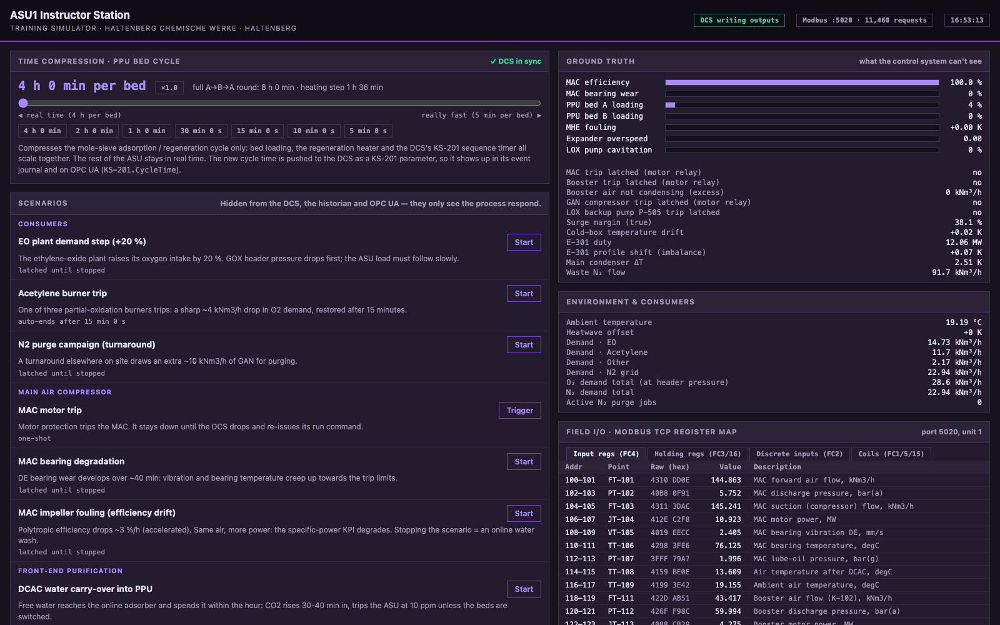

# Instructor station

The instructor station at http://localhost:8111 is the simulator side of the glass. It is
deliberately dark and violet, so nobody mistakes it for the DCS. It shows PPU time compression,
the fault scenarios, the plant's hidden ground truth and the raw Modbus register map.

Scenarios live only in the plant. The DCS, the historian and OPC UA never see them, only their
effects, just like in a real plant. That is what makes the data worth analysing.

## Scenarios

| Scenario | What the operator sees |
|---|---|
| EO plant demand step | GOX header drops; the pumped LOX runs into its load limit FY-501 and the backup vaporizer covers the rest. Purity sits at the spec edge until the air load is raised |
| Acetylene burner trip | Sharp O₂ demand drop for 15 min |
| N₂ purge campaign | GAN demand +10 kNm³/h: K-503 load and power (JI-514) go up |
| MAC motor trip | I-100 ASU shutdown: expander, booster, LOX pump and GAN compressor trip with it. The backups hold both headers: E-507 the GOX header (~23 h from a 65 % tank), E-508 the GAN header (~14 h from 60 %) |
| MAC bearing degradation | VI-105 / TI-106 creep up over ~40 min → H alarm → HH trip |
| MAC impeller fouling | Same air, more MW: KPI-701 specific power drifts up |
| DCAC water carry-over | CO₂ breakthrough at the PPU outlet ~35 min in → 10 ppm trip unless beds are switched |
| Regeneration heater fault | KS-201 "regeneration incomplete", breakthrough one cycle later |
| Booster motor trip | I-110 → I-500: without booster air the pumped LOX can't vaporize, so P-501 trips; vaporizer takes the header. Without the cold LOX stream the E-301 cold end warms (TI-301). Restart within ~10 min or the reboiler floods (LIC-404 HH → I-100) |
| LOX pump cavitation | PI-511 unsteady and falling over ~5 min → LL → I-500; the E-301 cold end then warms (TI-301 H). The suction re-cools in ~5 min, then P-501 can be restarted |
| GAN compressor K-503 trip | I-503: the GAN header dips to ~7.6 bar(g) while PIC-504 hands over to the LIN backup (P-506 / E-508). The column vents the GAN it no longer sends out |
| LOX backup pump P-505 trip | I-505 alarm "no GOX backup" and nothing else, until the next P-501 or ASU trip: then the GOX header collapses. Reset I-505 and restart P-505 |
| Expander loss of loading | Overspeed trip. Without the expander draw E-301 gets out of balance: the warm-end ΔT closes to ~0 and the cold end warms (TI-301 H after ~20 min); the reboiler level drains over hours |
| MHE fouling | Warm-end ΔT creeps up (H after ~70 min), the cold end warms with it |
| Hydrocarbon event | Hydrocarbons in the intake rise six-fold. The pumped LOX flushes them out with the product, so AI-603 only becomes a problem while P-501 is down |
| Heatwave | Less MAC capacity, more power, more water load on the PPU |

After a trip, see [Restart after a trip](Process-behaviour#restart-after-a-trip).

### At the other sites

Port Arden (http://localhost:8121) and Vadhana (http://localhost:8131) have their own instructor
station, with the scenarios their equipment allows and their own customer names
([Global sites](Global-sites)):

- **Port Arden:** the consumer scenarios are a refinery O₂ demand step, a POX burner trip and a
  customer purge campaign on the N₂ pipeline. One extra scenario: **LOX pump motor trip (duty
  pump)**. The DCS starts the standby pump; GOX dips for a few seconds, no trip, alarm
  `LOXPB.AUTOSTART` (or `LOXP.AUTOSTART`). Swap back by starting the tripped pump and stopping the
  other.
- **Vadhana:** no N₂ purge campaign and no GAN compressor trip (no GAN product). The demand step
  and the burner trip become an extra furnace load and an oxygen lance trip at the steel works.

## Time compression

Most of the plant runs in real time on purpose: a load change takes ~40 min, purity recovery after
a restart ~1 h. Only the **PPU bed cycle** can be sped up, with the slider, from *real time*
(4 h per bed at Haltenberg, 3 h at Port Arden, 2 h at Vadhana) to *really fast* (5 min per bed).
Ticks are provided for the shorter cycles down to 5 min.

- **What scales:** bed loading, the regeneration heater and the DCS's KS-201 sequence timer all
  scale together. The rest of the ASU stays in real time.
- **Path to the DCS:** the plant pushes the new value to the DCS as a KS-201 parameter. It
  appears in the event journal and on OPC UA as `KS-201.CycleTime`.
- **Persistence:** the DCS stores it in `data/dcs_state.json`, and the plant follows the DCS
  after a restart.

Tip for a lively trend: compress the cycle to 5 min for ~15 min, then set it back.
