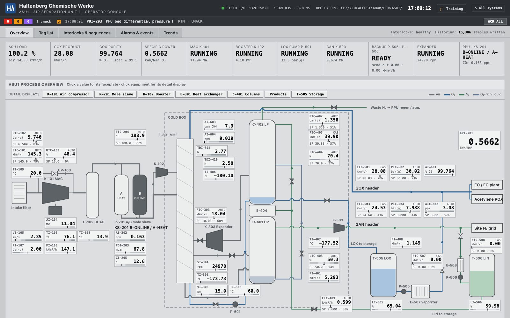
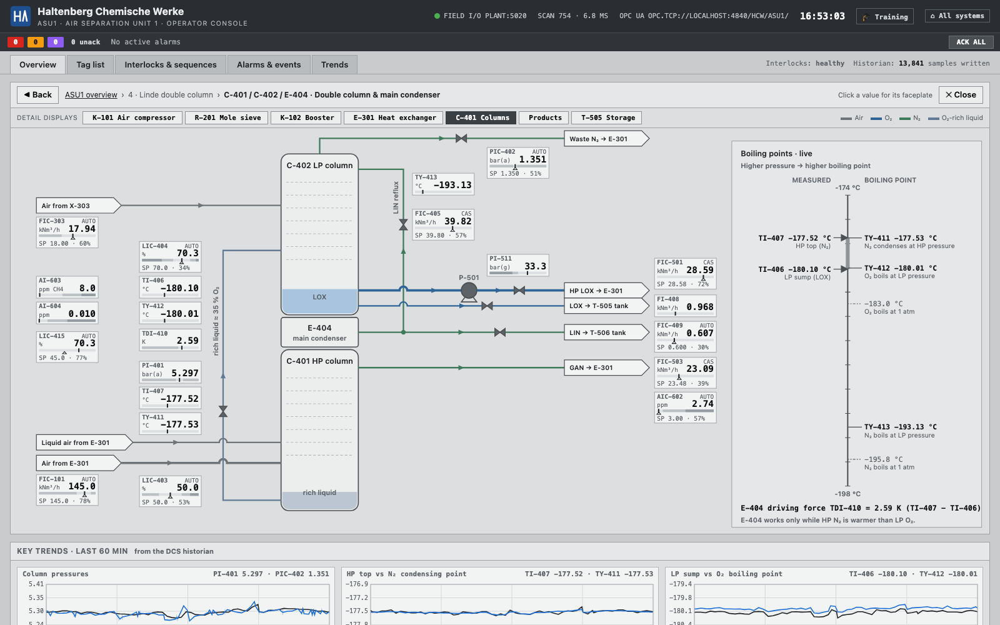
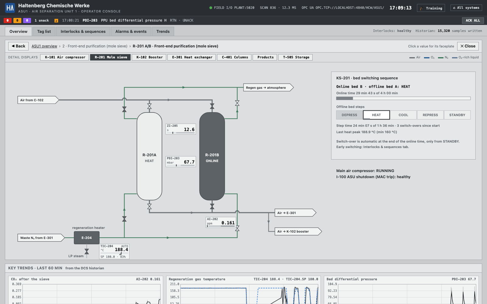
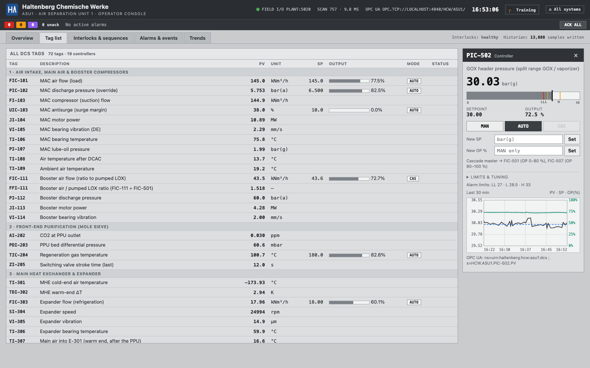
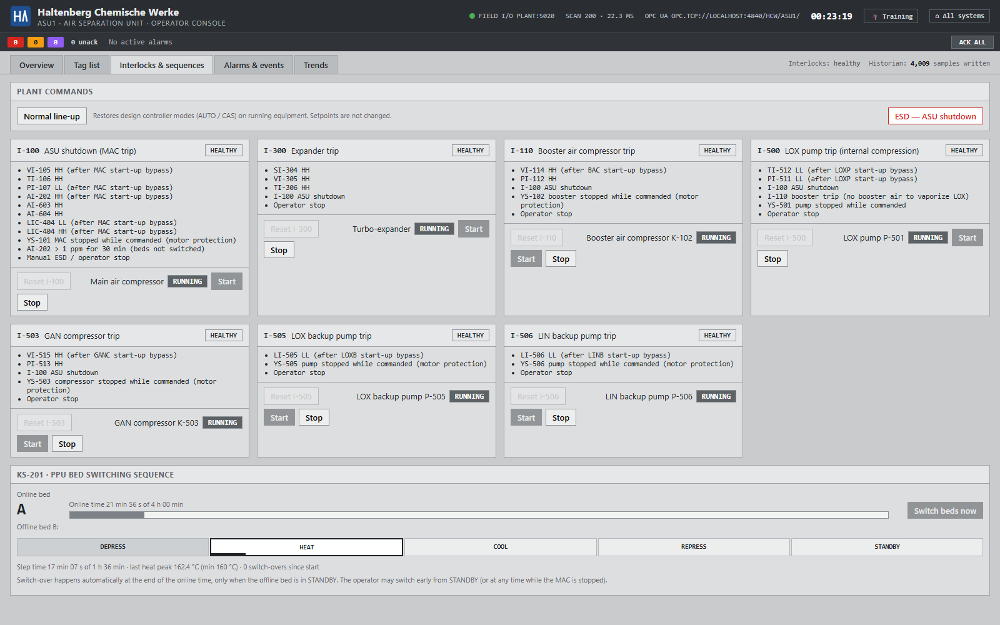
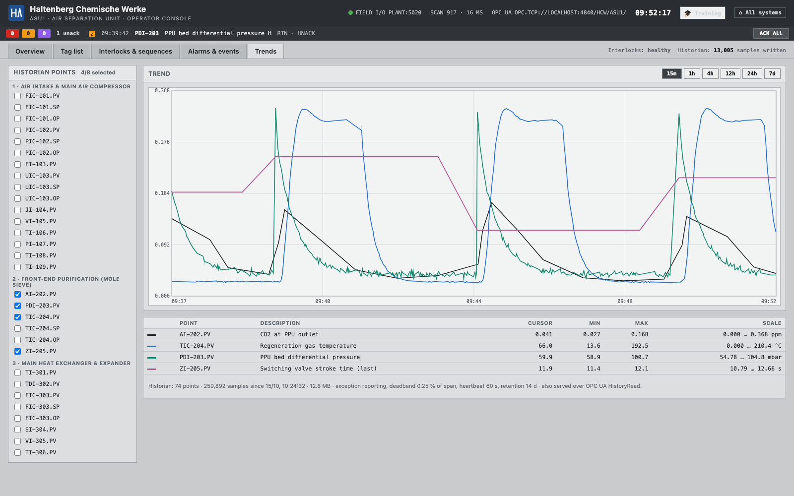
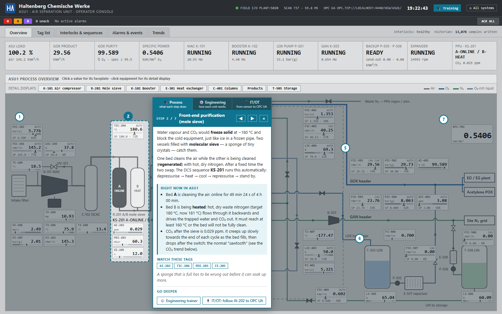

# Operator console

The DCS operator console is at http://localhost:8110/operator. It follows **ISA-101**
(high-performance HMI): grey by default, saturated colour only for alarms (priority 1 red,
2 amber, 3 violet, bad quality magenta). Process media get muted colours so you can tell lines
apart: oxygen blue, nitrogen green.

## Process overview

The whole unit on one display (ISA-101 level 2). Click any value to open its faceplate, or click
equipment to open its detail display.

Every data block shows the tag's value and a small bar: the tag's full range, darker zones beyond
its alarm limits, the PV as a pointer and, for controllers, the SP as a hollow triangle.

## Detail displays

Each unit has a **detail display** (level 3) with every stream and instrument of that unit:

| Display | Covers |
|---|---|
| `K-101` | Intake filter, main air compressor, antisurge recycle, C-102 aftercooler |
| `R-201` | Mole-sieve beds A/B, E-204 regeneration heater, KS-201 sequence panel |
| `K-102` | Booster air compressor, its ratio to the pumped LOX (internal compression) |
| `E-301` | Main heat exchanger: every stream's temperature at both ends; X-303 expander inlet / outlet temperature and pressure |
| `C-401` | HP / LP columns, E-404 main condenser, P-501 LOX pump, boiling-point scale |
| `products` | GOX and GAN headers, consumers, K-503 GAN compressor, PIC-502 / PIC-504 split ranges |
| `T-505` | LOX / LIN tanks, backup pumps P-505 / P-506, backup vaporizers E-507 / E-508 |

How to use them:
- Open one by clicking the equipment on the overview, from the *Detail displays* bar, or with a
  direct link such as `/operator#detail/E-404` (any equipment tag of a display works).
- The arrows at the edge of a display are links: follow a stream from display to display.
- **◀ Back** returns to the previous display (the browser's Back button works too). **✕ Close** or
  Esc returns to the overview.
- Values, faceplates, alarms and trends behave exactly as on the overview.

The double column and main condenser, with a live boiling-point scale: measured column
temperatures against the boiling points at column pressure. The calculated tags `TY-411`
(N₂ condensing temperature at HP pressure), `TY-412` (O₂ boiling temperature at LP pressure) and
`TY-413` (N₂ boiling temperature at LP pressure) are historized and published over OPC UA like
every other tag.

The mole-sieve display shows both beds, the valve line-up commanded by the KS-201 sequence and the
step progress.

The heat-exchanger display shows every stream through E-301 with its temperature at both ends,
and the expander's inlet and outlet. The values come from one heat balance, so they agree with each
other ([details](Process-behaviour#main-heat-exchanger-e-301-a-simple-heat-balance)).

## Tag list and faceplate

Every DCS tag with PV, SP, output and mode. The faceplate switches MAN/AUTO/CAS, changes setpoints
and the SP ramp rate, and shows a 30-minute trend.

## Interlocks and sequences

Each interlock with its causes and first-out, equipment start/stop with permissives,
**Normal line-up**, ESD, and the KS-201 mole-sieve bed switching sequence. How to restart after a
trip: [Process behaviour](Process-behaviour#restart-after-a-trip).

## Alarms and events

Alarm summary with acknowledge, and the event journal (alarms, trips, sequence steps, operator
actions) stored in the historian.

## Historian trends

Up to 8 points, 15 min to 7 days. Here the PPU cycle is compressed to 5 min per bed: CO₂ at the PPU
outlet, regeneration gas temperature, bed ΔP and valve stroke time over three bed switch-overs.

## 🎓 Training overlay

**🎓 Training** in the console header walks students through the process step by step. It:
- Dims the overview except for one process step and numbers the steps ①–⑦.
- Shows a card with a plain-language explanation and what that step is doing **right now**,
  e.g. which bed is heating and to what temperature, or whether the vaporizer is helping out.
- Lists the tags worth watching; clicking one opens its faceplate.

Step with ◀ ▶ (or the arrow keys) or click a numbered circle; Esc closes it. Like the rest of the
console, it is built only from DCS data. It never reveals the instructor's hidden scenarios.

## Deep links

Every view can be opened directly, which is also how the screenshots are taken (headless Chrome):

| Link | Opens |
|---|---|
| `/operator#overview`, `#tags`, `#ilk`, `#alarms`, `#trends` | a tab |
| `/operator#detail/C-401` | a detail display |
| `/operator?tag=PIC-502` | a faceplate |
| `/operator?training=1&step=2` | the training overlay at a step |
| `/operator?trend=AI-202.PV,TIC-204.PV&range=15` | trend points and window (minutes) |
