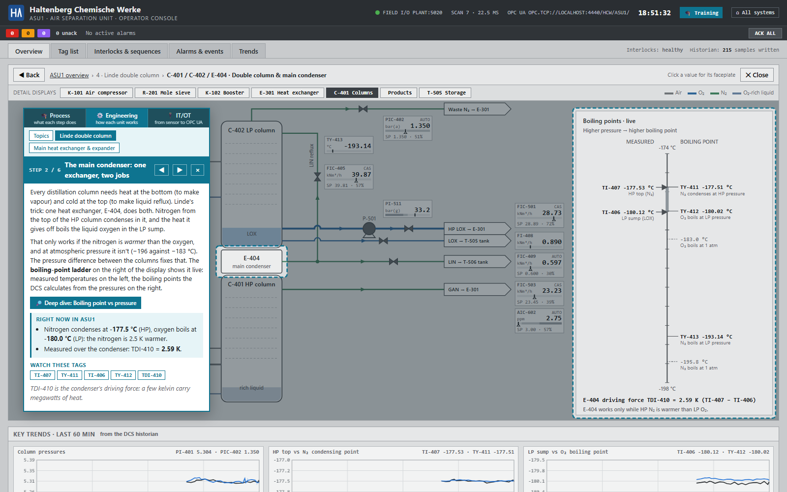
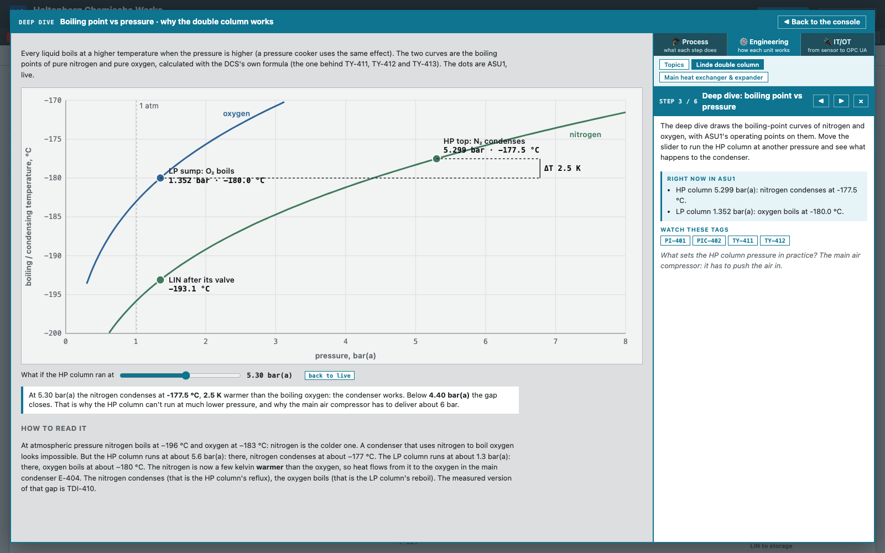
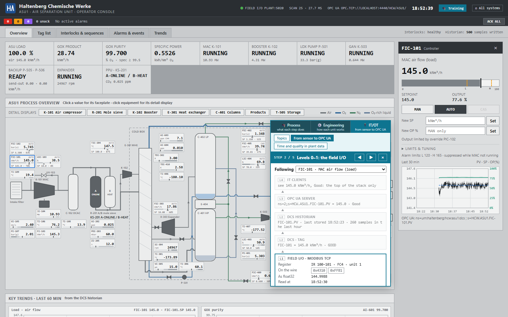

# Trainers

ASU1 has three trainers, one per audience. They all explain the same running plant, with live
values, at a different depth. All three are **overlays on the operator console**: a card on top of
the live displays, so you never leave the console.

| Trainer | For | What it does |
|---|---|---|
| 🎓 **Process** | everyone, no background needed | walks through the whole plant on the overview, in plain language |
| ⚙️ **Engineering** | people who want to know how a unit works | guided walks through the live detail displays, plus deep dives into the physics |
| 🔌 **IT/OT** | IT/OT specialists | follows one value from the sensor to OPC UA, and explains what dead time, exception reporting and quality mean for anyone who analyses plant data |

Open them with **🎓 Training** in the console header, or from the hub (http://localhost:8110,
"Learn · ASU1 trainers"). The console never opens a lesson by itself: reopening it brings you to the
plain console. The 🎓 button remembers where you were.

## The card

- **The switch** at the top of the card, [🎓 Process | ⚙️ Engineering | 🔌 IT/OT], changes the depth
  and **keeps your place**: on the column step of the Process trainer, ⚙️ Engineering opens the
  column topic; on the IT/OT side it follows the step's first tag. The Process steps also have
  "Go deeper" buttons that do the same.
- **Topics** (Engineering and IT/OT) sit under the switch; "Topics" lists them.
- **◀ ▶** (or the arrow keys) step through a topic, **×** (or Esc on the overview) closes the card.
- A step **steers the console**: it opens the right display, dims everything except the part the
  step is about, and can open a faceplate. You can still click around freely; "↺ Back to this
  step's display" brings you back.
- **Deep dives** open in a panel over the console, with the card beside the figure. "◀ Back to the
  console" (or Esc) closes the panel; "🔎 Open the deep dive" reopens it.
- Every step has a **Right now in ASU1** box built from live DCS data, and buttons for the tags worth
  watching (a click opens the faceplate). Like the console, the trainers only use DCS data. They
  never reveal the instructor's hidden scenarios.

## ⚙️ Engineering trainer

**Linde double column** (6 steps, on the C-401 display):
1. Two columns on top of each other: how distillation separates air.
2. The main condenser: one exchanger that condenses nitrogen and boils oxygen, with the live
   boiling-point ladder.
3. *Deep dive:* **boiling point vs pressure**. The nitrogen and oxygen curves, drawn with the DCS's
   own formula (the one behind TY-411 … TY-413), with ASU1's operating points on them. A slider
   runs the HP column at another pressure and shows when the condenser stops working.
4. *Deep dive:* **liquids that cool themselves**. The boiling-point table, and the two liquids that
   flash across their valves into the LP column: LIN from TY-411 to TY-413, and the rich liquid (an
   ideal-mixture estimate at 35 % O₂).
5. Reflux: the AIC-602 → FIC-405 cascade.
6. The sump: level, the LOX pump, the LIC-415 override and hydrocarbons in the boiling oxygen.

**Main heat exchanger & expander** (4 steps, on the E-301 display):
1. Counter-current flow, the warm end and the cold end, the warm-end ΔT TDI-302.
2. *Deep dive:* **the temperature profile**. Every stream through E-301 with its live end
   temperatures, and the boiling pumped LOX.
3. Internal compression: why the booster air follows the oxygen in a ratio (FFI-111, TI-512).
4. The expander: how X-303 makes the plant's cold (TI-315 → TI-317).

## 🔌 IT/OT trainer

**From sensor to OPC UA** (5 steps). The card shows one tag at every layer of the stack, at the same
moment, with the field at the bottom and IT at the top. Each layer has a one-line summary; the
step's layer is open, and a click opens any other:

| Layer | What you see, live |
|---|---|
| L0 instrument | the field point, e.g. FT-101, or "calculated from …" for a calculated tag |
| L1 field I/O | the Modbus input registers, the two 16-bit words on the wire, the float32 they make; the output register the DCS writes back |
| L2 DCS | the tag with unit, range, alarm limits, SP / OP / mode and quality |
| L2 historian | the deadband and heartbeat, the last stored sample, how many of the last hour's 3,600 scans were stored, and the stored samples of the last 15 minutes |
| L3 OPC UA | NodeId, browse path, type, StatusCode, endpoint, and a Python snippet that reads the node |
| L4 IT | what every client sees: the top of the stack only |

**Click any value on the console** to follow that tag instead, or pick one from the list in the card.

**Time and quality in plant data** (3 steps):
1. *Deep dive:* **cause and effect are minutes apart**. A dead-time-and-lag step response with
   sliders, the same pair of tags (FIC-501, AI-601) from the historian, and what that means for
   correlations and machine-learning features.
2. *Deep dive:* **not every scan is stored**. The historian's own storage rule on a ten-minute
   signal: change the deadband and see the stored samples and the error. Why averages must be
   time-weighted.
3. **Bad is not zero**: Good, Bad (no I/O) and not applicable, on the console, in the historian
   and over OPC UA.

## Deep links

| Link | Opens |
|---|---|
| `/operator?training=1&step=4` | the Process trainer at a step |
| `/operator?training=eng`, `/operator?training=ot` | a trainer's topic list |
| `/operator?training=eng&topic=C-401&step=2` | a topic at a step (steps count from 0) |
| `/operator?training=ot&topic=datapath&step=1&tag=PIC-502` | the IT/OT data path for a tag |

The data path comes from `GET /api/datapath?tag=<TAG>` (see [Data access](Data-access)).

## Planned

More topics are planned: the mole sieve, compressor surge, control strategies (cascade, split
range, override, ratio), interlocks and trips. See
[ROADMAP.md](https://github.com/itotinsider/haltenberg-chemische-werke-uns/blob/main/ROADMAP.md).
